# SMART WASTE BIN (SWB) — ESPECIFICACIÓN Y DISEÑO DE DIAGRAMAS UML DE ARQUITECTURA
**Proyecto de Aula — Ingeniería de Sistemas — 6to Semestre**  
**Institución:** Corporación Universitaria Rafael Núñez / UNICOLOMBO  
**Autores del Proyecto:** Klever Polo Bolívar & Juan Camilo Puello  
**Materia:** Ingeniería de Software / Electiva de Programación  
**Versión del Documento:** 2.0 (Consolidado Web, Móvil e IoT)

---

## INTRODUCCIÓN Y ALCANCE DE LA ARQUITECTURA

El sistema **Smart Waste Bin (SWB)** es una plataforma ciberfísica e integral orientada a la recolección inteligente de residuos y reciclaje gamificado en entornos urbanos y universitarios. Integra:
1. **Estaciones Físicas IoT:** Contenedores sensorizados con celdas de carga y ultrasonido para medir peso y volumetría en tiempo real, con límite operativo de 50.0 kg.
2. **Aplicación Móvil (Android Java):** Cliente para el ciudadano que permite autenticación, escaneo QR de estaciones, registro de depósitos, consulta de billetera ecológica, visualización de leaderboard y canje de puntos a dinero en efectivo (Nequi/Daviplata a razón de 10 pts = \$100 COP).
3. **Plataforma Web Administrativa (PHP / Apache / Glassmorphism UI):** Panel de telemetría y logística con geolocalización de contenedores en Cartagena de Indias, monitoreo de estados (Activo / Bloqueado) y gestión de usuarios.
4. **Capa de Persistencia (MariaDB InnoDB):** Base de datos relacional transaccional (`bd_smartbin`) con control de concurrencia y auditoría de puntos.

A continuación se presentan formalmente los **10 diagramas de arquitectura UML** solicitados para la entrega del proyecto de aula.

---

## 1. DIAGRAMAS DE CASOS DE USO (UML USE CASE DIAGRAM)

### 1.1 Diagrama de Casos de Uso General del Sistema
Muestra la interacción global de los tres actores principales:
* **Ciudadano / Usuario Móvil:** Usuario registrado que deposita material, acumula y canjea puntos.
* **Administrador / Operador de Aseo:** Gestiona el parque de SmartBins, usuarios y logística de vaciado.
* **Sistema IoT / Sensores de Estación:** Actor tecnológico que captura métricas físicas y notifica saturación.

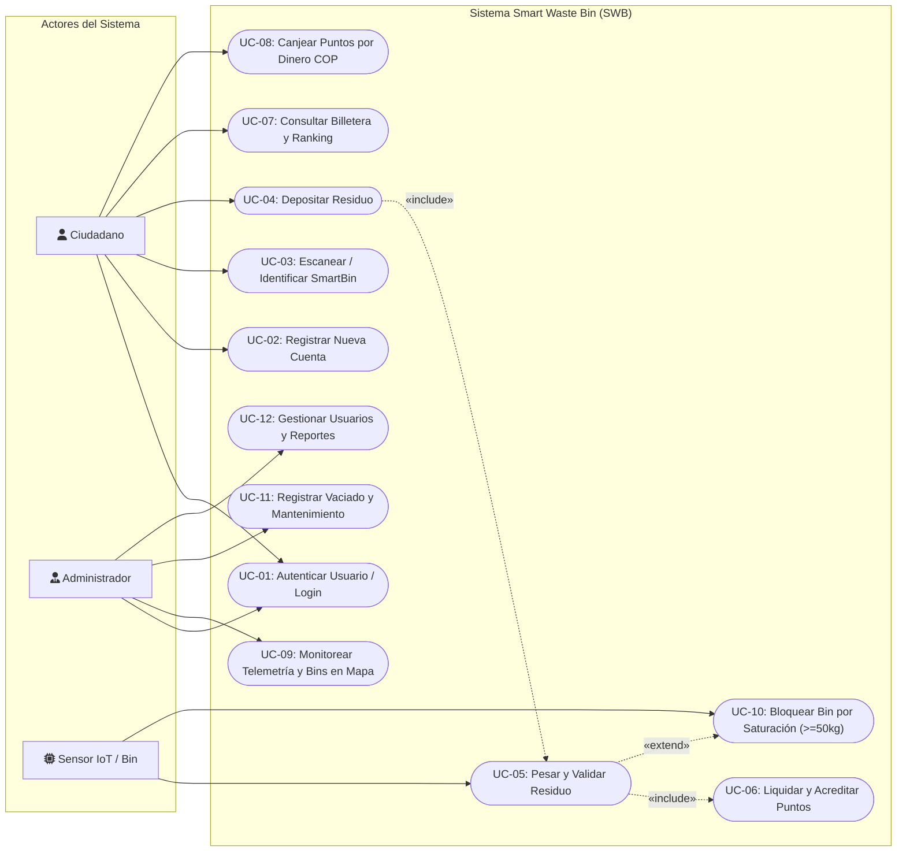

---

### 1.2 Diagramas de Casos de Uso por Partes (Subsistemas)

#### Subsistema A: Autenticación y Perfil de Usuario
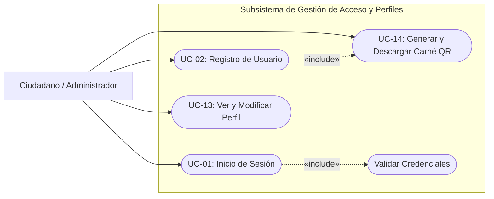

#### Subsistema B: Depósito y Reciclaje IoT
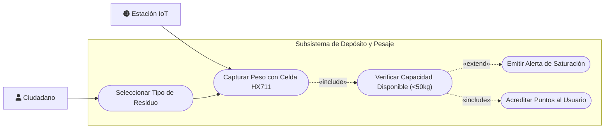

#### Subsistema C: Gamificación, Puntos y Canjes
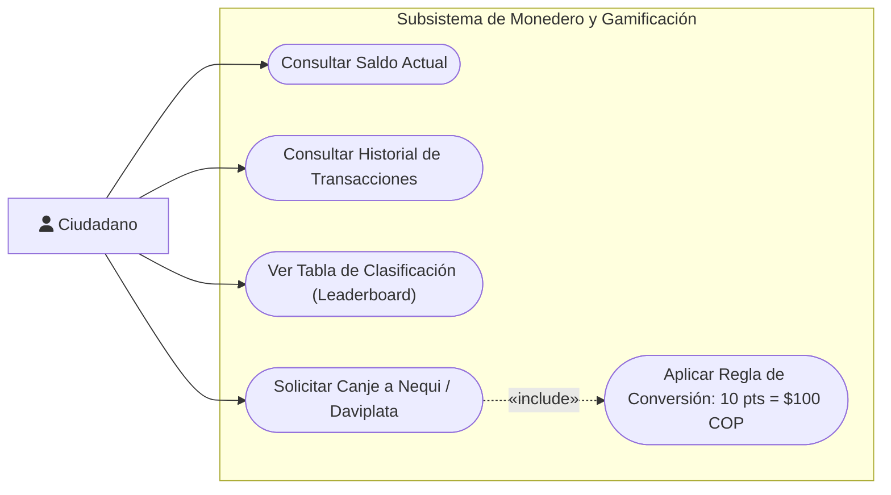

#### Subsistema D: Supervisión, Telemetría y Operación de Aseo (Admin)
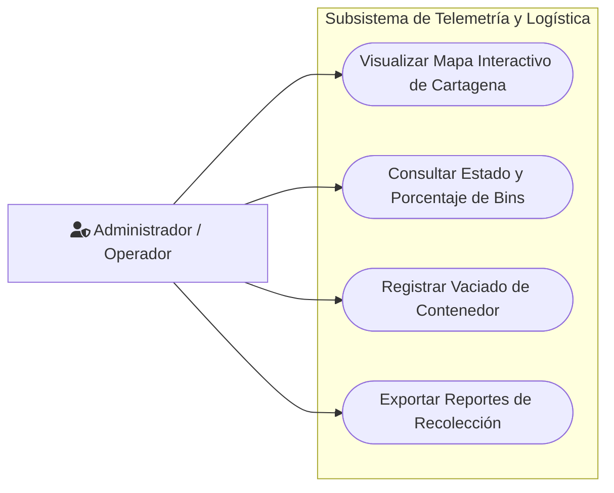

---

## 2. DIAGRAMA DE CLASES (UML CLASS DIAGRAM)

Modela las entidades de dominio, los controladores de la aplicación móvil y los servicios backend que sustentan la persistencia en `bd_smartbin`.

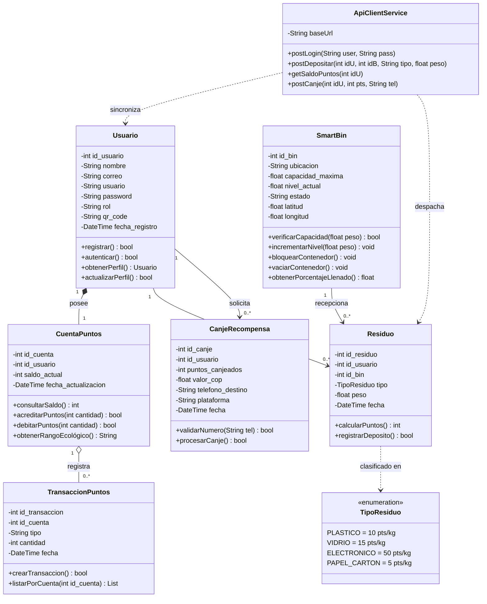

---

## 3. DIAGRAMA DE SECUENCIA (UML SEQUENCE DIAGRAM)

Detalla la interacción dinámica paso a paso durante el evento crítico del sistema: **Registro de depósito de residuo con pesaje, validación de capacidad en SmartBin, actualización de saldo y bloqueo preventivo**.

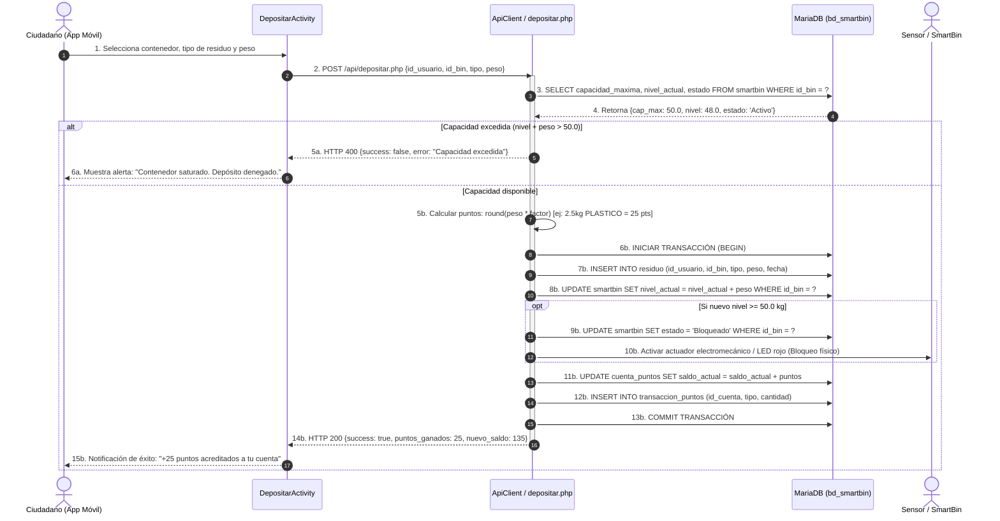

---

## 4. DIAGRAMA DE ACTIVIDADES (UML ACTIVITY DIAGRAM)

Muestra el flujo de control procedimental para el ciclo completo de reciclaje, desde la captura del material hasta la emisión de recompensas y evaluación de saturación.

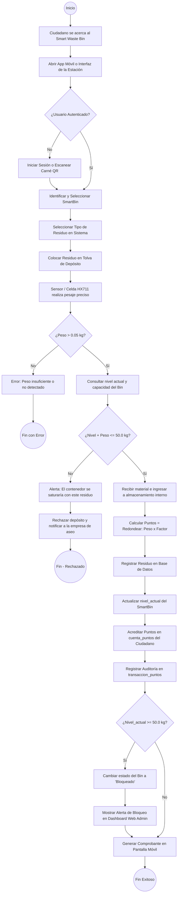

---

## 5. DIAGRAMA DE ESTADOS (STATE MACHINE DIAGRAM)

Representa los estados finitos y transiciones por los que atraviesa una estación física `SmartBin` durante su operación en campo.

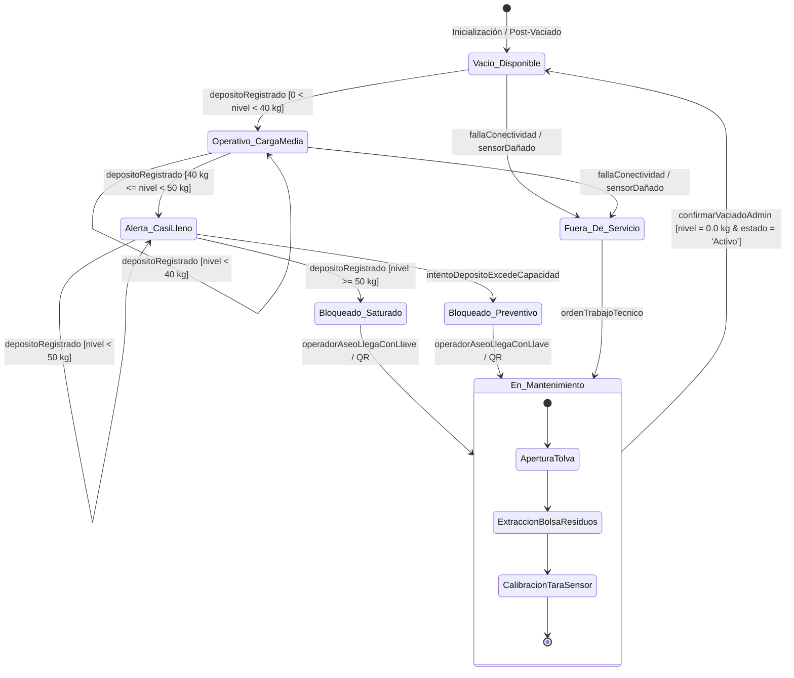

---

## 6. DIAGRAMA DE COMPONENTES (UML COMPONENT DIAGRAM)

Describe la organización y dependencias de los módulos de software en las tres capas: Cliente Móvil, Servidor Backend y Persistencia.

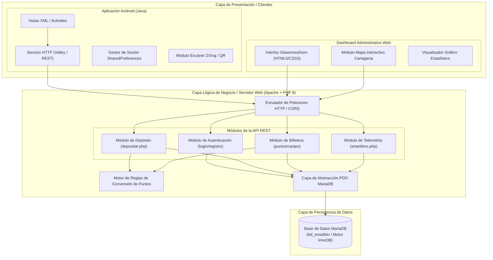

---

## 7. DIAGRAMA DE DESPLIEGUE (UML DEPLOYMENT DIAGRAM)

Especifica la topología de hardware, nodos físicos y los canales de comunicación de red utilizados para el despliegue del ecosistema Smart Waste Bin.

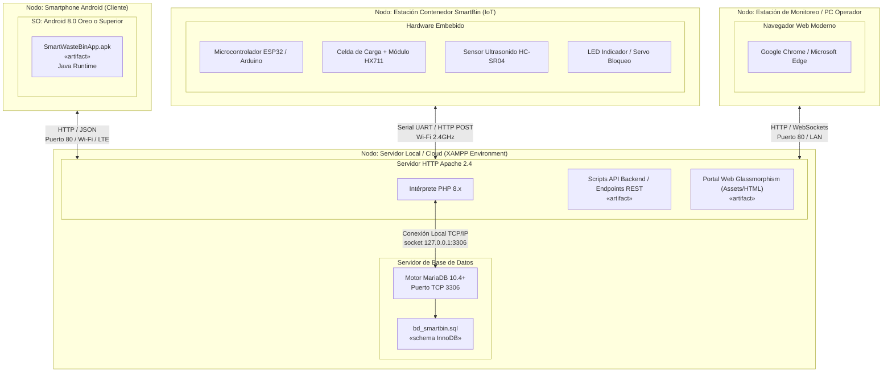

---

## 8. DIAGRAMA DE PAQUETES (UML PACKAGE DIAGRAM)

Ilustra la modularización, namespaces y estructura de carpetas tanto del cliente móvil Android como del servidor web PHP.

```mermaid
flowchart TB
    subgraph PKG_Android["Paquete Móvil: com.unicolombo.smartwastebin"]
        subgraph PKG_Vistas["views"]
            V1["LoginActivity"]
            V2["MainActivity"]
            V3["DepositarActivity"]
            V4["PuntosActivity"]
            V5["PerfilActivity"]
        end

        subgraph PKG_Controladores["controllers"]
            C1["AuthController"]
            C2["DepositoController"]
            C3["PuntosController"]
        end

        subgraph PKG_Modelos["models"]
            M1["Usuario"]
            M2["SmartBin"]
            M3["Residuo"]
            M4["Transaccion"]
        end

        subgraph PKG_Network["network"]
            N1["VolleySingleton"]
            N2["ApiEndpoints"]
            N3["JsonParser"]
        end

        subgraph PKG_Utils["utils"]
            U1["SessionManager"]
            U2["Constants"]
            U3["Formatters"]
        end
    end

    subgraph PKG_Backend["Paquete Backend: /Smart_waste_bin_6to_semestre"]
        subgraph PKG_Config["config/"]
            CFG1["conexion.php"]
            CFG2["cors.php"]
        end

        subgraph PKG_API["api/"]
            A1["login.php"]
            A2["registro.php"]
            A3["depositar.php"]
            A4["get_puntos.php"]
            A5["canjear_puntos.php"]
            A6["get_bins.php"]
            A7["leaderboard.php"]
        end

        subgraph PKG_ViewsWeb["views/"]
            VW1["dashboard.php"]
            VW2["mapa.php"]
            VW3["usuarios.php"]
        end

        subgraph PKG_Assets["assets/"]
            AST1["css/glassmorphism.css"]
            AST2["js/mapa_cartagena.js"]
            AST3["img/"]
        end
    end

    %% Dependencias entre paquetes
    PKG_Vistas ..> PKG_Controladores
    PKG_Controladores ..> PKG_Modelos
    PKG_Controladores ..> PKG_Network
    PKG_Network ..> PKG_Utils
    
    PKG_Network ..> PKG_API : Peticiones HTTP
    PKG_ViewsWeb ..> PKG_Assets
    PKG_API ..> PKG_Config
    PKG_ViewsWeb ..> PKG_Config
```

---

## 9. DIAGRAMA DE COMUNICACIÓN (UML COMMUNICATION DIAGRAM)

Presenta la colaboración entre objetos en tiempo de ejecución para el escenario de **Depósito y Notificación de Puntos**, haciendo énfasis en el orden secuencial de los enlaces y mensajes transmitidos.

```mermaid
flowchart TD
    Ciudadano(["1: Ciudadano"])
    UI[":DepositarActivity"]
    Client[":ApiClientService"]
    API[":ApiDepositarRouter"]
    BinObj[":SmartBinEntity"]
    ResObj[":ResiduoEntity"]
    PtosObj[":CuentaPuntosEntity"]
    DB[":MariaDB_PDO"]

    %% Mensajes numerados
    Ciudadano -->|"1.0: presionarBotonDepositar(tipo, peso)"| UI
    UI -->|"1.1: enviarPeticion(idUsuario, idBin, tipo, peso)"| Client
    Client -->|"1.2: POST /api/depositar.php"| API
    
    API -->|"1.3: consultarCapacidad(idBin)"| BinObj
    BinObj -->|"1.4: SELECT nivel_actual, cap_max"| DB
    DB -->>|"1.5: retorna métricas"| BinObj
    
    API -->|"1.6: instanciar(tipo, peso)"| ResObj
    ResObj -->|"1.7: calcularPuntos()"| ResObj
    
    API -->|"1.8: INSERT INTO residuo"| DB
    API -->|"1.9: UPDATE smartbin SET nivel_actual"| DB
    API -->|"2.0: acreditarPuntos(saldo_ganado)"| PtosObj
    PtosObj -->|"2.1: UPDATE cuenta_puntos"| DB
    PtosObj -->|"2.2: INSERT INTO transaccion_puntos"| DB
    
    API -->>|"2.3: {success: true, puntos_obtenidos: 25}"| Client
    Client -->>|"2.4: callbackExito()"| UI
    UI -->>|"2.5: notificarUsuario('Depósito acreditado!')"| Ciudadano
```

---

## 10. DIAGRAMA DE OBJETOS (UML OBJECT DIAGRAM)

Muestra una instantánea concreta en tiempo de ejecución (Snapshot) con los objetos instanciados, sus atributos poblados con datos verídicos de la base de datos `bd_smartbin` y los enlaces activos entre ellos.

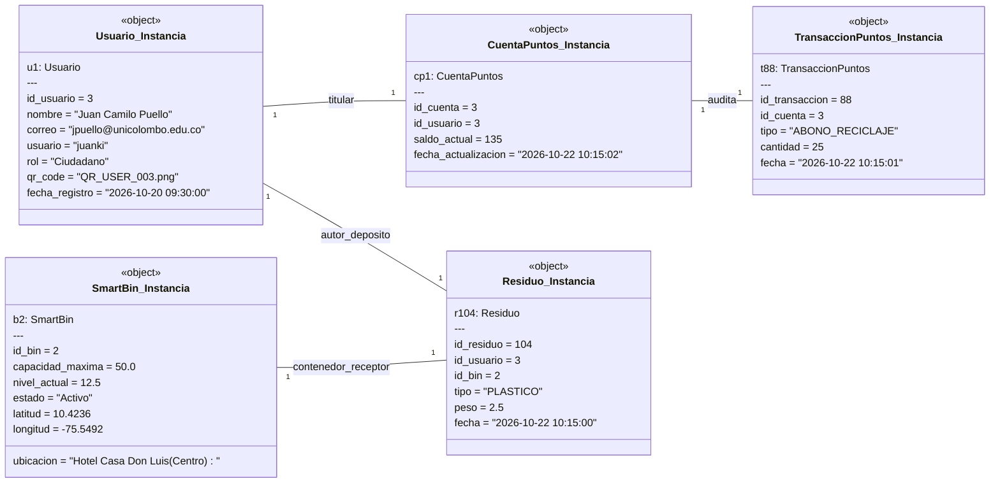

---

## 11. MODELO RELACIONAL (PERFIL DE DATOS DE AMBLER)

Modela el esquema físico de la base de datos `bd_smartbin` en MariaDB (motor InnoDB), especificando claves primarias `«PK»`, foráneas `«FK»` y únicas `«UK»`, tipos de datos e integridad referencial en cascada.

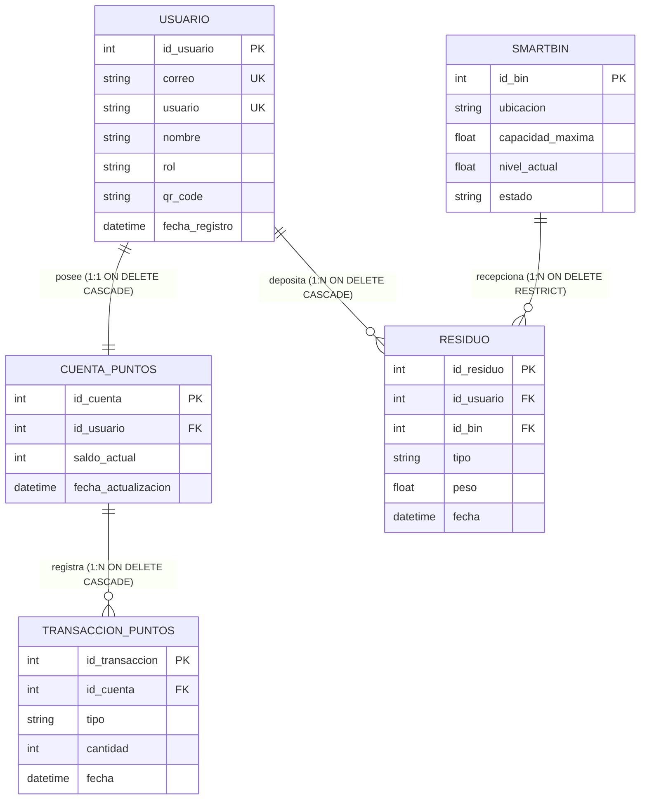

---

## 12. MODELO ENTIDAD-RELACIÓN (DER EN NOTACIÓN DE CHEN)

Modelo conceptual de datos conforme a la notación de Chen: entidades (rectángulos), relaciones (rombos), atributos (óvalos con PK subrayada) y participación total (línea doble).

```
[USUARIO] === (posee) === [CUENTA_PUNTOS] === (registra) === [TRANSACCION_PUNTOS]
   ||                                                               
(deposita)                                                          
   ||                                                               
[RESIDUO] === (recepciona) === [SMARTBIN]
```

* **Participación Total (Línea Doble):** Toda `CUENTA_PUNTOS` depende de la existencia de un `USUARIO`. Todo `RESIDUO` pertenece obligatoriamente a un `USUARIO` y a una estación `SMARTBIN`.
* **Cardinalidades:**
  * `USUARIO` (1, parcial) --- posee --- (1, total) `CUENTA_PUNTOS`
  * `CUENTA_PUNTOS` (1, parcial) --- registra --- (N, total) `TRANSACCION_PUNTOS`
  * `USUARIO` (1, parcial) --- deposita --- (N, total) `RESIDUO`
  * `SMARTBIN` (1, parcial) --- recepciona --- (N, total) `RESIDUO`

---

## TABLA RESUMEN DE TRAZABILIDAD Y COBERTURA TÉCNICA

| No. | Tipo de Modelo / Diagrama | Propósito Arquitectónico en Smart Waste Bin | Componente Clave Representado |
|:---:|:---|:---|:---|
| **1** | **Casos de Uso** | Requisitos funcionales de Ciudadanos, Administradores y Sensores IoT. | App Móvil, Panel Web y Sensores. |
| **2** | **Clases** | Modelo de dominio orientado a objetos y persistencia en MariaDB. | Clases de negocio, reglas de cálculo y enums. |
| **3** | **Secuencia** | Ciclo de vida temporal del depósito de material y acreditación de puntos. | API REST `depositar.php` y base de datos. |
| **4** | **Actividades** | Algoritmo de validación de pesaje, capacidad y ramas de desborde/bloqueo. | Decisión de saturación (>= 50kg). |
| **5** | **Estados** | Máquina de estados de la papelera inteligente física (SmartBin). | Transición: Disponible $\rightarrow$ Lleno $\rightarrow$ Bloqueado $\rightarrow$ Vaciado. |
| **6** | **Componentes** | Interfaces provistas (○) y requeridas (Ɑ) entre cliente, API y BD. | Volley, Módulos API, Motor de Reglas y PDO. |
| **7** | **Despliegue** | Topología física de hardware, red WiFi/LTE y servidor Apache/MariaDB. | Smartphone, Tarjeta IoT, Servidor XAMPP. |
| **8** | **Paquetes** | Organización de paquetes Java Android y árbol de directorios PHP. | `com.unicolombo.smartwastebin` y `Smart_waste_bin_6to_semestre/`. |
| **9** | **Comunicación** | Interacción sincrónica entre objetos con numeración formal de mensajes. | Transmisión y confirmación de eventos de depósito. |
| **10** | **Objetos** | Instantánea (snapshot) de memoria con datos reales de la BD del proyecto. | Usuario `juanki`, SmartBin `Hotel Don Luis`, 25 puntos. |
| **11** | **Modelo Relacional** | Esquema físico de tablas, claves `«PK»`, `«FK»`, `«UK»` y reglas ACID. | Tablas InnoDB normalizadas en `bd_smartbin`. |
| **12** | **Modelo DER (Chen)** | Modelo conceptual con entidades, relaciones, atributos y participación total. | Entidades conceptuales y restricciones de existencia. |
