# MANUAL TÉCNICO Y DE USUARIO
## SISTEMA DE GESTIÓN DE PAPELERAS INTELIGENTES (SMART WASTE BINS - ECO FRIENDLY)

> [!INFO] Ficha Técnica del Documento
> - **Proyecto de Aula:** Smart Waste Bin (SWB) – 6to Semestre.
> - **Entidad Académica:** Fundación Universitaria Colombo Internacional (UNICOLOMBO) – Programa de Ingeniería de Sistemas.
> - **Estructura Metodológica:** Basado rigurosamente en la norma **IEEE 1063-2001** y la **Guía Estructurada de Manuales Técnicos de Aplicación (SENA - FAVA / CIMI)**.
> - **Arquitectura Base:** LAMP/WAMP Stack (Linux/Windows, Apache 2.4, MariaDB 10.4, PHP 8.2), Interfaz Web Responsiva Glassmorphism (HTML5, CSS3, JavaScript ES6) e IoT SmartBin Georreferenciado.

---

## Tabla de Contenidos

1. [Introducción](#introducción)
2. [Mapa de Contenido General](#mapa-de-contenido-general)
3. [PARTE I: MANUAL DEL USUARIO](#parte-i-manual-del-usuario)
   - [1.1 Alcance del Manual de Usuario](#11-alcance-del-manual-de-usuario)
   - [1.2 Requisitos de Conocimiento para Operar el Sistema](#12-requisitos-de-conocimiento-para-operar-el-sistema)
   - [1.3 Requerimientos de Hardware y Software (Equipo Cliente)](#13-requerimientos-de-hardware-y-software-equipo-cliente)
   - [1.4 Política de Seguridad y Privacidad](#14-política-de-seguridad-y-privacidad)
   - [1.5 Ingreso y Autenticación en el Sistema](#15-ingreso-y-autenticación-en-el-sistema)
   - [1.6 Mapa de Navegación y Elementos de Interfaz](#16-mapa-de-navegación-y-elementos-de-interfaz)
   - [1.7 Descripción Detallada de las Funciones del Sistema](#17-descripción-detallada-de-las-funciones-del-sistema)
     - [1.7.1 Módulo de Registro de Ciudadanos](#171-módulo-de-registro-de-ciudadanos)
     - [1.7.2 Módulo de Inicio de Sesión](#172-módulo-de-inicio-de-sesión)
     - [1.7.3 Módulo de Panel de Usuario (Dashboard Mi Cuenta)](#173-módulo-de-panel-de-usuario-dashboard-mi-cuenta)
     - [1.7.4 Módulo de Registro y Pesaje de Residuos](#174-módulo-de-registro-y-pesaje-de-residuos)
     - [1.7.5 Módulo de Mapa Interactivo y Ubicaciones de SmartBins](#175-módulo-de-mapa-interactivo-y-ubicaciones-de-smartbins)
     - [1.7.6 Módulo de Canje y Retiro de Puntos](#176-módulo-de-canje-y-retiro-de-puntos)
     - [1.7.7 Módulo de Historial de Transacciones](#177-módulo-de-historial-de-transacciones)
     - [1.7.8 Módulo de Tabla de Clasificación Comunitaria (Leaderboard)](#178-módulo-de-tabla-de-clasificación-comunitaria-leaderboard)
     - [1.7.9 Módulo de Gestión de Perfil y Cuenta](#179-módulo-de-gestión-de-perfil-y-cuenta)
     - [1.7.10 Módulo de Administración y Monitoreo de Red IoT](#1710-módulo-de-administración-y-monitoreo-de-red-iot)
   - [1.8 Información sobre la Mesa de Ayuda y Soporte](#18-información-sobre-la-mesa-de-ayuda-y-soporte)
   - [1.9 Catálogo y Resolución de Mensajes de Error](#19-catálogo-y-resolución-de-mensajes-de-error)
4. [PARTE II: MANUAL TÉCNICO](#parte-ii-manual-técnico)
   - [2.1 Alcance del Manual Técnico](#21-alcance-del-manual-técnico)
   - [2.2 Descripción de Procesos y Requerimientos](#22-descripción-de-procesos-y-requerimientos)
     - [2.2.1 Requerimientos Funcionales (RF)](#221-requerimientos-funcionales-rf)
     - [2.2.2 Requerimientos No Funcionales (RNF)](#222-requerimientos-no-funcionales-rnf)
     - [2.2.3 Reglas de Negocio del Sistema](#223-reglas-de-negocio-del-sistema)
   - [2.3 Diagramas UML de Modelado (OMG UML 2.5.1 / Draw.io)](#23-diagramas-uml-de-modelado)
     - [2.3.1 Diagrama de Casos de Uso del Sistema (General y Subsistemas)](#231-diagrama-de-casos-de-uso-del-sistema)
     - [2.3.2 Diagrama de Clases del Dominio](#232-diagrama-de-clases-del-dominio)
     - [2.3.3 Diagrama de Secuencia: Depósito de Residuo y Puntos](#233-diagrama-de-secuencia-depósito-de-residuo-y-puntos)
     - [2.3.4 Diagrama de Actividades](#234-diagrama-de-actividades)
     - [2.3.5 Diagrama de Máquina de Estados](#235-diagrama-de-máquina-de-estados)
     - [2.3.6 Diagrama de Componentes](#236-diagrama-de-componentes)
     - [2.3.7 Diagrama de Arquitectura de Despliegue](#237-diagrama-de-arquitectura-de-despliegue)
     - [2.3.8 Diagrama de Paquetes](#238-diagrama-de-paquetes)
     - [2.3.9 Diagrama de Comunicación](#239-diagrama-de-comunicación)
     - [2.3.10 Diagrama de Objetos](#2310-diagrama-de-objetos)
   - [2.4 Administración de Usuarios y Seguridad](#24-administración-de-usuarios-y-seguridad)
   - [2.5 Modelo Relacional y Diccionario de Datos de la Base de Datos](#25-modelo-relacional-y-diccionario-de-datos-de-la-base-de-datos)
     - [2.5.1 Diagrama Entidad-Relación (DER)](#251-diagrama-entidad-relación-der)
     - [2.5.2 Diccionario de Datos Exhaustivo](#252-diccionario-de-datos-exhaustivo)
   - [2.6 Descripción de la Plataforma de Ejecución e Infraestructura](#26-descripción-de-la-plataforma-de-ejecución-e-infraestructura)
   - [2.7 Documentación del Código Fuente y Estructura de Directorios](#27-documentación-del-código-fuente-y-estructura-de-directorios)
     - [2.7.1 Árbol de Componentes del Proyecto](#271-árbol-de-componentes-del-proyecto)
     - [2.7.2 Catálogo Detallado de Módulos y Scripts](#272-catálogo-detallado-de-módulos-y-scripts)
   - [2.8 Acuerdos de Niveles de Servicio (ANS / SLA) y Matriz de Escalamiento](#28-acuerdos-de-niveles-de-servicio-ans--sla-y-matriz-de-escalamiento)
5. [Glosario de Términos](#glosario-de-términos)
6. [Referencias Bibliográficas](#referencias-bibliográficas)
7. [Control del Documento](#control-del-documento)

---

## Introducción

El presente documento constituye el compendio integral del **Manual de Usuario** y el **Manual Técnico** del proyecto de aula **Smart Waste Bin (SWB)**, formulado y desarrollado por estudiantes del 6to Semestre del programa de Ingeniería de Sistemas de la Fundación Universitaria Colombo Internacional (UNICOLOMBO).

La problemática de la gestión de residuos sólidos en entornos urbanos y turísticos, específicamente en la ciudad de Cartagena de Indias, se caracteriza por la deficiente separación en la fuente, la ausencia de trazabilidad en tiempo real sobre el estado de llenado de los depósitos, y la carencia de incentivos tangibles que motiven a la ciudadanía a reciclar de manera constante y responsable.

**Smart Waste Bin** solventa este desafío mediante una solución integral basada en el ecosistema **IoT (Internet de las Cosas)** y plataformas web. A través de una red distribuida de contenedores inteligentes equipados con sensores ultrasónicos de nivel y celdas de carga para pesaje, geolocalizados estratégicamente en puntos de alto flujo del Centro Histórico y Getsemaní, el sistema registra cada depósito de material reciclable (plásticos, orgánicos, desechos electrónicos, papel y cartón), gamifica la experiencia mediante la adjudicación automática de eco-puntos acumulables y canjeables, y provee herramientas de telemetría y supervisión operativa para el vaciado óptimo y preventivo de los depósitos.

Este manual sigue las pautas pedagógicas e ingenieriles dictadas por el **Servicio Nacional de Aprendizaje (SENA)** para la elaboración de manuales técnicos de software y el estándar internacional **IEEE 1063-2001** para documentación de software.

---

## Mapa de Contenido General

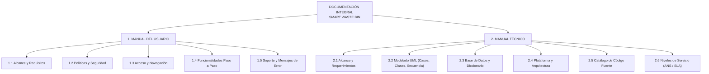

---

# PARTE I: MANUAL DEL USUARIO

El manual del usuario tiene como finalidad guiar paso a paso al ciudadano y al personal administrativo en la operación cotidiana de las funciones provistas por la plataforma **Smart Waste Bin**. Su redacción adopta un lenguaje comprensible, instructivo y formal, asistido por descriptores de control, tablas de flujo y lineamientos de acción inmediata.

---

### 1.1 Alcance del Manual de Usuario

| No | Ítem | Detalle |
| :---: | :--- | :--- |
| **1** | **Propósito** | Capacitar al usuario final en el acceso, interacción, registro de reciclaje, consulta de puntos y canje de beneficios ofrecidos por el sistema Smart Waste Bin. |
| **2** | **Público Objetivo** | Ciudadanos, recicladores, turistas, comerciantes locales y operadores de limpieza urbana en la ciudad de Cartagena. |
| **3** | **Ámbito de Operación** | Plataforma Web accesible mediante navegadores web en computadores de escritorio, tabletas y dispositivos móviles conectados a la red local o Internet. |
| **4** | **Límites de Aplicación** | Este manual no contempla el desensamble físico, mantenimiento eléctrico ni calibración de hardware de los sensores ultrasónicos y celdas de carga de los contenedores físicos, los cuales son objeto del manual de mantenimiento de hardware. |

---

### 1.2 Requisitos de Conocimiento para Operar el Sistema

Para interactuar de manera eficiente con la plataforma Smart Waste Bin, el usuario final únicamente requiere poseer destrezas elementales:
1. Conocimientos básicos de computación o manejo de teléfonos inteligentes (smartphones).
2. Nociones elementales sobre navegación web (uso de barras de direcciones, clics, desplazamiento y llenado de formularios).
3. Comprensión general sobre la separación ecológica de residuos (plástico, vidrio, papel/cartón y aparatos electrónicos).
4. Familiaridad con el resguardo de claves personales de acceso.

---

### 1.3 Requerimientos de Hardware y Software (Equipo Cliente)

El sistema funciona bajo el estándar cliente-servidor web, lo que minimiza la carga de procesamiento en el equipo del usuario:

#### Requerimientos de Hardware (Cliente)
- **Dispositivo:** Computador de escritorio, portátil, tablet o smartphone Android/iOS.
- **Memoria RAM:** Mínimo 2 GB (Recomendado: 4 GB o superior).
- **Resolución de Pantalla:** Mínimo 360 x 640 px (móvil) / Óptimo 1366 x 768 px en adelante.
- **Conectividad:** Conexión a red WiFi, Ethernet o datos móviles con velocidad mínima de 1 Mbps.

#### Requerimientos de Software (Cliente)
- **Sistema Operativo:** Windows 10/11, macOS 11+, GNU/Linux (Ubuntu, Debian, Fedora), Android 9+ o iOS 14+.
- **Navegador Web Compatible:** Google Chrome (v90+), Mozilla Firefox (v88+), Microsoft Edge (v90+), Opera (v75+) o Safari (v14+). Habilitación obligatoria de JavaScript.

---

### 1.4 Política de Seguridad y Privacidad

> [!IMPORTANT] Compromisos de Seguridad del Usuario
> 1. **Confidencialidad de la Cuenta:** El nombre de usuario y correo electrónico asociados a su cuenta son de carácter personal e intransferible.
> 2. **Veracidad de la Información:** Al depositar residuos en los contenedores georreferenciados, el usuario se compromete a ingresar el peso fidedigno y seleccionar la tipología adecuada de material.
> 3. **Políticas de Anti-Fraude:** El sistema dispone de rutinas automáticas de auditoría para detectar discrepancias volumétricas. El intento deliberado de adulterar el saldo de eco-puntos ocasionará la suspensión preventiva de la cuenta.
> 4. **Cierre Seguro de Sesión:** Cuando se utilice un computador de acceso público, el usuario debe oprimir siempre el enlace **"Cerrar Sesión"** para evitar la usurpación de su saldo.

---

### 1.5 Ingreso y Autenticación en el Sistema

Para acceder a la plataforma, el usuario debe ingresar la URL asignada por el despliegue local o institucional en su navegador:

```text
http://localhost/Smart_waste_bin_6to_semestre/index.html
```

#### Pantalla Inicial de Bienvenida (Landing Portal)
Al ingresar a la URL anterior, el usuario visualizará la portada con el tema gráfico de naturaleza y follaje verde tropical:
- Oprime **"Iniciar Sesión"** si ya dispone de una cuenta activa.
- Oprime **"Registrarse"** si es su primer ingreso a la red comunitaria Smart Waste Bin.

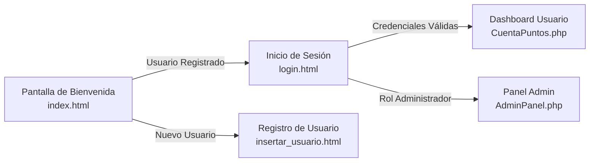

---

### 1.6 Mapa de Navegación y Elementos de Interfaz

La aplicación adopta una interfaz moderna basada en **Glassmorphism** (paneles translúcidos con desenfoque `backdrop-filter: blur(20px)` sobre fondo natural de hojas verdes). Los controles principales estandarizados son:

| Control | Representación / Elemento | Función Operativa |
| :--- | :---: | :--- |
| **Cajón de Texto Simple** | `<input type="text">` | Permite ingresar nombres, identificaciones numéricas o cuentas de usuario. |
| **Cajón de Correo Electrónico** | `<input type="email">` | Valida automáticamente el formato estándar `nombre@dominio.com`. |
| **Cajón de Selección (Dropdown)** | `<select><option>` | Permite elegir una opción acotada (ej. Tipo de residuo o Ubicación de papelera). |
| **Cajón Numérico con Decimales** | `<input type="number" step="0.01">` | Permite registrar el peso exacto en kilogramos (ej. 1.75 kg). |
| **Botón de Acción Primaria** | Fondo verde (`#2ecc71`) | Ejecuta la transacción (Guardar usuario, Iniciar sesión, Confirmar depósito, Canjear). |
| **Botón de Navegación / Retorno** | Enlace blanco translúcido | Permite regresar al panel central sin pérdida de estado. |

---

### 1.7 Descripción Detallada de las Funciones del Sistema

#### 1.7.1 Módulo de Registro de Ciudadanos
Permite crear una nueva cuenta en la base de datos comunitaria para acumular puntos por reciclaje.

| No | Campo | Tipo de Dato | Obligatorio | Descripción / Regla de Validación |
| :---: | :--- | :--- | :---: | :--- |
| **1** | **ID Usuario (Identificación)** | Numérico (hasta 5 dígitos) | Sí | Documento de identidad único o código universitario (ej: `10010`). |
| **2** | **Nombre Completo** | Alfanumérico (máx 100 caracteres) | Sí | Nombre y apellidos reales del ciudadano. |
| **3** | **Correo Electrónico** | Correo (máx 100 caracteres) | Sí | Debe ser único en el sistema. Formato `usuario@correo.com`. |
| **4** | **Nombre de Usuario** | Alfanumérico (máx 50 caracteres) | Sí | Nombre para el inicio de sesión (ej: `kpolo_eco`). |

**Paso a paso para el registro:**
1. En el portal de bienvenida, haz clic en **"Registrarse"**.
2. Completa los cuatro campos del formulario.
3. Haz clic en el botón verde **"Guardar Usuario"**.
4. El sistema notificará mediante una pantalla de confirmación la creación exitosa del usuario y la apertura automática de su monedero de eco-puntos con saldo inicial de **0 puntos**.
5. Haz clic en **"Ir a Iniciar Sesión"**.

---

#### 1.7.2 Módulo de Inicio de Sesión
Permite validar la identidad del usuario y otorgarle acceso a su monedero o al panel administrativo.

**Paso a paso:**
1. En la pantalla `login.html`, introduce tu **ID de Usuario** o tu **Nombre de Usuario**.
2. Haz clic en el botón verde **"Entrar al Panel"**.
3. El sistema evalúa los permisos:
   - Si el rol es `admin`, se redirige al **Panel de Control Administrativo** (`AdminPanel.php`).
   - Si el rol es `user`, se inicia la sesión y se redirige al **Dashboard de Mi Cuenta** (`CuentaPuntos.php`).

---

#### 1.7.3 Módulo de Panel de Usuario (Dashboard Mi Cuenta)
Es el centro de control del ciudadano. Ofrece visibilidad en tiempo real de:
- **Bienvenida personalizada:** Muestra el nombre registrado y alias del usuario.
- **Rango Ecológico:** Insignia que sube automáticamente según la constancia:
  - `Novato`: 0 a 99 puntos.
  - `Reciclador`: 100 a 499 puntos.
  - `Eco-Guerrero`: 500 a 999 puntos.
  - `Maestro Eco`: 1000 puntos o más.
- **Tarjeta de Saldo de Eco-Puntos:** Saldo numérico actualizado en tiempo real.
- **Métrica de Impacto Ambiental:** Total acumulado de kilogramos reciclados por el usuario.
- **Acciones Rápidas:**
  - 🗑️ **Registrar Depósito:** Registrar reciclaje en una papelera.
  - 🗺️ **Mapa SmartBins:** Localizar papeleras activas en la ciudad.
  - 💸 **Retirar Puntos:** Convertir puntos en dinero o premios.
  - 📋 **Historial de Transacciones:** Auditar todos los depósitos y retiros.
  - 🏆 **Leaderboard:** Ver ranking de los mejores recicladores.
  - ⚙️ **Editar Cuenta:** Modificar datos personales o eliminar cuenta.

---

#### 1.7.4 Módulo de Registro y Pesaje de Residuos
Simula y procesa la interacción con la papelera inteligente al momento de depositar material.

**Paso a paso:**
1. Haz clic en **"Registrar Depósito"** desde el dashboard.
2. En el campo **Tipo de Residuo**, selecciona una de las 4 fracciones ecológicas disponibles:
   - `Plástico`: Aporta **10 pts/kg**.
   - `Vidrio`: Aporta **15 pts/kg**.
   - `Electrónico`: Aporta **50 pts/kg**.
   - `Papel / Cartón`: Aporta **5 pts/kg**.
3. En el campo **Peso (Kilogramos)**, escribe la cantidad pesada por la celda de carga (ej. `2.5`).
4. En el campo **SmartBin (Ubicación)**, despliega la lista y selecciona el contenedor donde estás depositando el residuo (ej. *Bin #1 - Hotel Casa Don Luis*).
5. Oprime **"Registrar Depósito"**.
6. **Validación del sistema:**
   - Si el peso supera la capacidad restante de la papelera, el sistema impedirá el depósito e indicará los kilogramos exactos disponibles para evitar el desbordamiento.
   - Si el depósito es válido, el sistema añade los kilogramos a la papelera, acredita los eco-puntos al usuario, almacena el registro histórico y emite una alerta de éxito: *"¡Depósito exitoso! Has ganado X puntos"*.

---

#### 1.7.5 Módulo de Mapa Interactivo y Ubicaciones de SmartBins
Permite al ciudadano visualizar sobre el plano geográfico del Centro Histórico y Getsemaní de Cartagena (`mapa_cartagena.jpg`) la ubicación precisa de las 8 papeleras inteligentes activas en la red.

**Interacción en el mapa:**
1. Accede desde el botón **"Mapa SmartBins"**.
2. Cada papelera está indicada con un marcador circular con animación de pulso radar:
   - 🟢 **Verde:** Papelera en estado normal con capacidad disponible.
   - 🔴 **Rojo:** Papelera en estado **"Bloqueado"** (ha alcanzado los 50 kg de capacidad máxima).
3. Pasa el cursor (hover) sobre cualquier marcador: Se desplegará una tarjeta emergente con:
   - Identificador del contenedor (ej. `SmartBin #5`).
   - Dirección/Sitio turístico (ej. `Hotel Casona del Porvenir`).
   - Barra de progreso con el porcentaje de llenado actual (ej. `31.0% de 50 kg`).
   - Estado operativo (`Activo` / `Bloqueado`).

---

#### 1.7.6 Módulo de Canje y Retiro de Puntos
Permite redimir los eco-puntos acumulados mediante transferencias directas a cuentas móviles (Nequi / Daviplata) o bonos comerciales.

**Paso a paso:**
1. Desde el panel principal, haz clic en **"Retirar / Canjear Puntos"**.
2. Revisa la tasa de conversión en pantalla: **10 Puntos = $100 COP**.
3. Ingresa tu número de teléfono móvil de 10 dígitos (debe iniciar con el dígito `3`, ej: `3151234567`).
4. Digita la cantidad de puntos a retirar (no puede superar tu saldo actual).
5. El sistema calcula en vivo la equivalencia en dinero colombiano ($ COP).
6. Haz clic en **"Confirmar Retiro"**. El saldo se descuenta inmediatamente de tu billetera y se genera un comprobante de transacción.

---

#### 1.7.7 Módulo de Historial de Transacciones
Permite auditar el movimiento de la cuenta de puntos del usuario.
- Presenta una tabla con la fecha y hora exacta de cada evento.
- Tipo de movimiento (`DEPOSITO_PLASTICO`, `DEPOSITO_ELECTRONICO`, `RETIRO_TEL_3XXXXXXXXX`).
- Cantidad de puntos (en verde para ingresos con símbolo `+`, o en rojo para débitos con símbolo `-`).

---

#### 1.7.8 Módulo de Tabla de Clasificación Comunitaria (Leaderboard)
Fomenta la sana competencia ecológica en el aula y la ciudad:
- Muestra el listado de recicladores ordenados de mayor a menor según su saldo de puntos.
- Destaca con medallas conmemorativas los tres primeros puestos: 🥇 Oro, 🥈 Plata, 🥉 Bronce.
- Muestra los kilogramos totales aportados por cada participante a la preservación del ecosistema.

---

#### 1.7.9 Módulo de Gestión de Perfil y Cuenta
Permite al usuario mantener actualizada su información:
- Modificación de su nombre y alias.
- Opción de **"Eliminar Cuenta"** con advertencia de seguridad (elimina en cascada su historial de residuos y puntos acumulados para garantizar el cumplimiento de la ley de protección de datos personales).

---

#### 1.7.10 Módulo de Administración y Monitoreo de Red IoT
Exclusivo para usuarios con rol de administrador (ej. personal de aseo urbano o administradores del sistema como `KlevFT` o `godioreo`).

**Funcionalidades del Administrador:**
1. **Supervisión de Sensores y Nivel de Contenedores:** Tabla con las 8 papeleras, su capacidad máxima (50 kg), el nivel de carga actual y su porcentaje.
2. **Acción de Vaciado Operativo:** Cada fila dispone del botón rojo **"Vaciar"** (`vaciar_bin.php`), el cual simula la recolección física del camión de basura: restablece el nivel de carga a `0.0 kg` y desbloquea el contenedor para recibir nuevos residuos.
3. **Gestión de Usuarios:** Lista completa de ciudadanos registrados con facultad de eliminar usuarios que incumplan las normas.
4. **Métricas Globales:** Indicadores consolidados de reciclaje de toda la red urbana.

---

### 1.8 Información sobre la Mesa de Ayuda y Soporte

En caso de incidentes en la plataforma, incongruencias en la adjudicación de eco-puntos o reporte de una papelera inteligente dañada o vandalizada, comuníquese con el equipo de soporte técnico:

| Canal | Descripción / Detalle |
| :--- | :--- |
| **Responsable Principal** | Klever Adriano Polo Bolívar (Líder Técnico de Proyecto) |
| **Equipo de Soporte** | Juan Caro Ramírez, Diego Mejía Espinosa, Robert Pérez Maza |
| **Institución** | Fundación Universitaria Colombo Internacional (UNICOLOMBO) |
| **Correo de Atención** | `soporte.smartbin@unicolombo.edu.co` |
| **Horario de Operación** | Lunes a Viernes de 8:00 a.m. a 6:00 p.m. / Sábados de 8:00 a.m. a 12:00 m. |
| **Tiempo de Respuesta Estándar** | Menor a 24 horas hábiles |

---

### 1.9 Catálogo y Resolución de Mensajes de Error

| Código / Alerta | Causa del Problema | Acción Correctiva Sugerida |
| :--- | :--- | :--- |
| **"Error: Esta papelera está LLENA o BLOQUEADA"** | El contenedor seleccionado ha alcanzado los 50.0 kg de capacidad máxima. | Utiliza el módulo **Mapa SmartBins** para dirigirte al contenedor más cercano que tenga espacio libre. Espera a que el camión recolector vacíe el contenedor. |
| **"Error: El peso ingresado (X kg) excede la capacidad disponible"** | El residuo que intentas registrar sobrepasa los kilogramos restantes de la papelera. | Deposita una porción menor del residuo que no sobrepase el cupo remanente, o selecciona otra papelera con mayor disponibilidad. |
| **"Error: Saldo insuficiente o cantidad inválida"** | Intentas canjear una cantidad superior a tus eco-puntos actuales o un valor negativo/nulo. | Consulta tu saldo en el dashboard y digita un monto menor o igual al balance disponible. |
| **"Error: El número de teléfono debe empezar por 3 y tener exactamente 10 dígitos"** | El formato de la línea móvil para retiro no coincide con las líneas de Colombia (ej. Nequi/Daviplata). | Digita un número válido de 10 números que inicie por 3 (ej. `3123456789`). |
| **"Usuario o identificación incorrectos"** | Las credenciales no se encuentran registradas en la tabla `usuario`. | Verifica el número de identificación o apodo. Si aún no tienes cuenta, dirígete a `insertar_usuario.html`. |
| **"Error en la conexión con la base de datos"** | El servidor MySQL/MariaDB en XAMPP se encuentra detenido. | Notifica al soporte técnico para iniciar el servicio `mysqld` en el servidor. |

---

# PARTE II: MANUAL TÉCNICO

El manual técnico está dirigido a desarrolladores de software, administradores de bases de datos, arquitectos de soluciones y personal de infraestructura TI encargados del despliegue, auditoría, soporte de segundo nivel y mantenimiento correctivo/evolutivo de **Smart Waste Bin**.

---

### 2.1 Alcance del Manual Técnico

El objetivo general es detallar exhaustivamente la arquitectura lógica, física y de datos del sistema **Smart Waste Bin**, exponiendo la especificación formal de requerimientos, diagramas UML unificados, el diccionario de datos de MariaDB, los algoritmos de asignación y cálculo de puntos, y las rutas de escalamiento de soporte.

#### Objetivos Específicos
1. Documentar los modelos estructurales y de comportamiento del sistema mediante estándares UML (Casos de Uso, Clases, Secuencia y Despliegue).
2. Detallar la normalización y estructura relacional de la base de datos `bd_smartbin`.
3. Describir la interacción entre la capa controladora PHP, las vistas HTML5/CSS3 y el motor transaccional SQL.
4. Establecer las pautas para el mantenimiento del código fuente y los acuerdos de niveles de servicio (ANS).

---

### 2.2 Descripción de Procesos y Requerimientos

#### 2.2.1 Requerimientos Funcionales (RF)

| Código | Nombre del Requerimiento | Descripción Técnica |
| :---: | :--- | :--- |
| **RF01** | **Gestión de Registro de Usuarios** | El sistema debe permitir almacenar el identificador numérico, nombre, correo electrónico, apodo y rol en la tabla `usuario`, generando simultáneamente una cuenta de puntos vinculada. |
| **RF02** | **Autenticación y Control de Acceso** | El sistema debe verificar la existencia del usuario mediante consulta SQL y gestionar variables de sesión (`$_SESSION['user_id']`, `$_SESSION['rol']`), restringiendo vistas de administración. |
| **RF03** | **Registro de Depósitos y Telemetría** | El sistema debe recibir la identificación del usuario, la papelera de destino, la fracción de residuo y el peso detectado por el sensor, validando la holgura de capacidad física. |
| **RF04** | **Cálculo Automatizado de Puntos** | El sistema debe ejecutar el algoritmo de ponderación según el tipo de material reciclable depositado, acreditando el valor resultante en la cuenta de puntos del ciudadano. |
| **RF05** | **Bloqueo Preventivo de Contenedor** | Al alcanzar o superar los 50 kg (`capacidad_maxima`), el sistema debe actualizar el atributo `estado` a `'Bloqueado'`, rechazando nuevos depósitos hasta su vaciado. |
| **RF06** | **Monitoreo Georreferenciado en Mapa** | El sistema debe renderizar en pantalla un mapa cartográfico con las 8 estaciones georreferenciadas de Cartagena, reflejando dinámicamente el porcentaje de llenado y alertas de saturación. |
| **RF07** | **Canje Transaccional de Puntos** | El sistema debe debitar eco-puntos mediante transacciones ACID protegidas contra concurrencia (`mysqli_begin_transaction`), registrando el número de teléfono receptor. |
| **RF08** | **Vaciado Físico y Desbloqueo** | El módulo administrador debe permitir restablecer el nivel actual a `0.0 kg` y retornar el estado del contenedor a `'Activo'`. |
| **RF09** | **Tabla Comunitaria de Posiciones** | El sistema debe clasificar a los usuarios en orden descendente a través de sentencias `ORDER BY saldo_actual DESC` y contabilizar los kilogramos depositados. |

#### 2.2.2 Requerimientos No Funcionales (RNF)

| Código | Atributo | Criterio de Cumplimiento |
| :---: | :--- | :--- |
| **RNF01** | **Rendimiento** | El tiempo de respuesta en el procesamiento de transacciones de depósito y consulta de saldo debe ser inferior a 2.0 segundos bajo condiciones normales de red. |
| **RNF02** | **Disponibilidad** | El sistema debe operar con un tiempo de actividad del 99.5% en horario diurno, asegurando servicio ininterrumpido en zonas turísticas. |
| **RNF03** | **Integridad de Datos** | La base de datos debe mantener integridad referencial estricta mediante restricciones de clave foránea `ON DELETE CASCADE` entre cuentas, transacciones y residuos. |
| **RNF04** | **Compatibilidad y Responsividad** | Las vistas deben construirse bajo estándares HTML5, CSS3 y Vanilla JavaScript sin dependencias pesadas, soportando pantallas de 360px a 1920px. |
| **RNF05** | **Usabilidad** | La interfaz debe ofrecer retroalimentación inmediata al usuario mediante ventanas modales o alertas descriptivas frente a cualquier anomalía de llenado o saldo. |

#### 2.2.3 Reglas de Negocio del Sistema

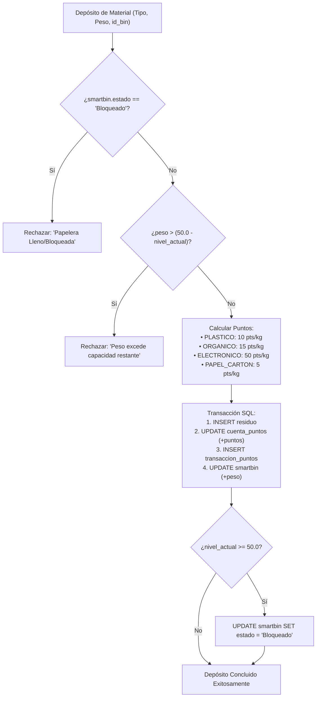

---

### 2.3 Diagramas UML de Modelado (OMG UML 2.5.1 / Draw.io)

El modelado visual del sistema **Smart Waste Bin (SWB)** se fundamenta rigurosamente en la norma internacional **OMG UML 2.5.1** y en los estándares de ingeniería de software de la institución. Todos los diagramas cuentan con especificación gráfica nativa en **Draw.io** (`.drawio` editables y renders oficiales `.png` ubicados en `diagramas/`), código ejecutable Mermaid para visualización en plataformas Markdown / Obsidian, y la trazabilidad exhaustiva de requisitos funcionales y de datos.

---

#### 2.3.1 Diagrama de Casos de Uso del Sistema (OMG UML 2.5.1, Cláusula 18)

> **Archivos Oficiales:** `diagramas/01-casos-de-uso.drawio` | `diagramas/01-casos-de-uso.png`  
> **Convenciones Aplicadas:** Actores principales a la izquierda (humanos con monigote estándar Fig. 18.6); actor tecnológico a la derecha con cabeza de pantalla y estereotipo `«device»` (Fig. 18.8). Límite del sistema formal con `«subsystem»`. Flechas `«include»` apuntando al caso incluido y flechas `«extend»` apuntando al caso base con nota de condición.

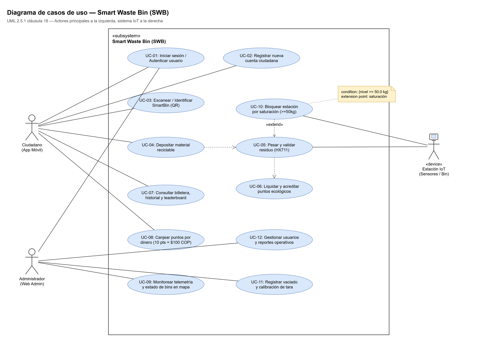

```mermaid
flowchart LR
    %% Actores
    subgraph Actores["Actores del Ecosistema"]
        C["fa:fa-user Ciudadano\n(App Móvil)"]
        A["fa:fa-user-tie Administrador\n(Web Admin)"]
        S["fa:fa-microchip Estación IoT\n«device»"]
    end

    %% Sujeto del Sistema
    subgraph Sistema["«subsystem» Smart Waste Bin (SWB)"]
        UC1(["UC-01: Autenticar Usuario / Login"])
        UC2(["UC-02: Registrar Nueva Cuenta"])
        UC3(["UC-03: Escanear / Identificar SmartBin"])
        UC4(["UC-04: Depositar Residuo"])
        UC5(["UC-05: Pesar y Validar Residuo (HX711)"])
        UC6(["UC-06: Liquidar y Acreditar Puntos"])
        UC7(["UC-07: Consultar Billetera y Ranking"])
        UC8(["UC-08: Canjear Puntos por Dinero COP"])
        UC9(["UC-09: Monitorear Telemetría y Mapa"])
        UC10(["UC-10: Bloquear Estación por Saturación (>=50kg)"])
        UC11(["UC-11: Registrar Vaciado y Calibración"])
        UC12(["UC-12: Gestionar Usuarios y Reportes"])
    end

    %% Relaciones
    C --> UC1
    C --> UC2
    C --> UC3
    C --> UC4
    C --> UC7
    C --> UC8

    A --> UC1
    A --> UC9
    A --> UC11
    A --> UC12

    S --> UC5
    S --> UC10

    UC4 -.->|«include»| UC5
    UC5 -.->|«include»| UC6
    UC10 -.->|«extend»\ncond: {nivel >= 50kg}| UC5
```

##### Subsistemas de Casos de Uso
1. **Gestión de Acceso:** `UC-01` (Login) y `UC-02` (Registro con carné QR dinámico).
2. **Depósito y Pesaje IoT:** `UC-03` (Identificar papelera), `UC-04` (Depositar), `UC-05` (Pesar), con extensión hacia `UC-10` (Bloqueo preventivo al alcanzar 50.0 kg).
3. **Billetera Ecológica:** `UC-06` (Acreditación inmediata), `UC-07` (Historial y Leaderboard), `UC-08` (Canje: 10 pts = $100 COP a Nequi/Daviplata).
4. **Telemetría y Logística:** `UC-09` (Mapa interactivo de Cartagena), `UC-11` (Vaciado operativo con tara de sensores) y `UC-12` (Reportes de recolección).

---

#### 2.3.2 Diagrama de Clases del Dominio (OMG UML 2.5.1, Cláusulas 9 y 11)

> **Archivos Oficiales:** `diagramas/02-clases.drawio` | `diagramas/02-clases.png`  
> **Convenciones Aplicadas:** Visibilidad completa (`+`, `-`, `#`), tipos explícitos de atributos y métodos, cardinalidades en ambos extremos, rombo de composición pegado al contenedor `Usuario` y agregación en `CuentaPuntos`. Sin duplicidad de claves foráneas como atributos simples.

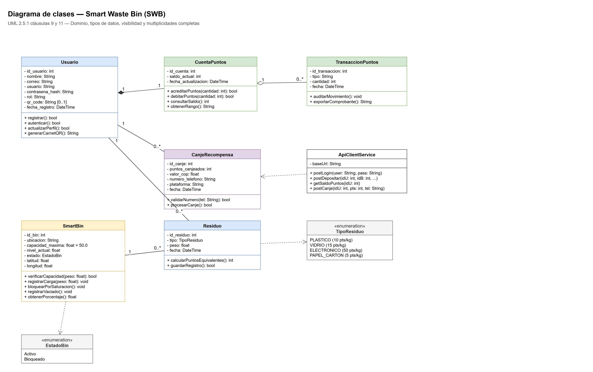

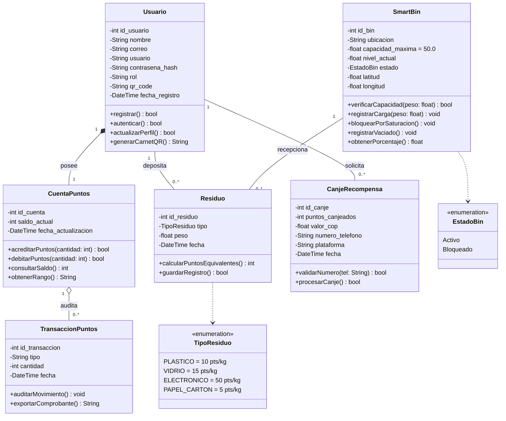

---

#### 2.3.3 Diagrama de Secuencia: Depósito de Residuo y Puntos (OMG UML 2.5.1, Cláusula 17)

> **Archivos Oficiales:** `diagramas/03-secuencia.drawio` | `diagramas/03-secuencia.png`  
> **Convenciones Aplicadas:** Marco formal `sd`, participantes con líneas de vida y cajas de activación. Fragmento combinado `alt` para la evaluación de desborde ($>50.0\text{ kg}$) vs transacción exitosa, y fragmento `opt` para el cambio de estado a *Bloqueado*.

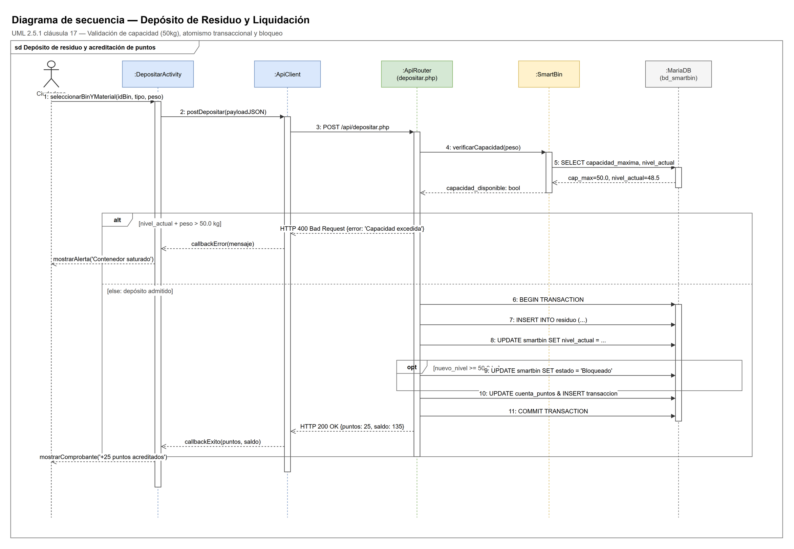

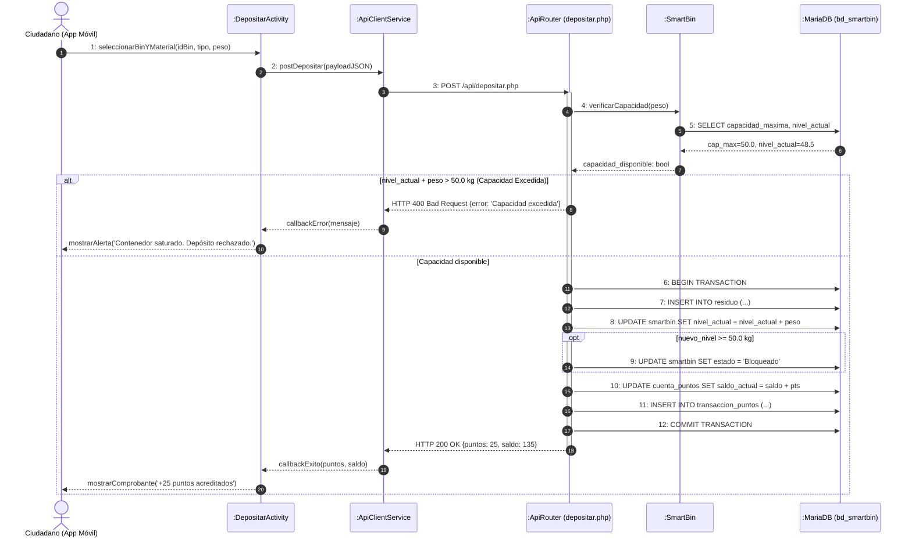

---

#### 2.3.4 Diagrama de Actividades (OMG UML 2.5.1, Cláusula 15)

> **Archivos Oficiales:** `diagramas/04-actividades.drawio` | `diagramas/04-actividades.png`  
> **Convenciones Aplicadas:** Marco formal `act`, nodo inicial `●`, rombos de decisión con guardas explícitas entre corchetes `[...]`, bifurcaciones de saturación y nodos finales `◉`.

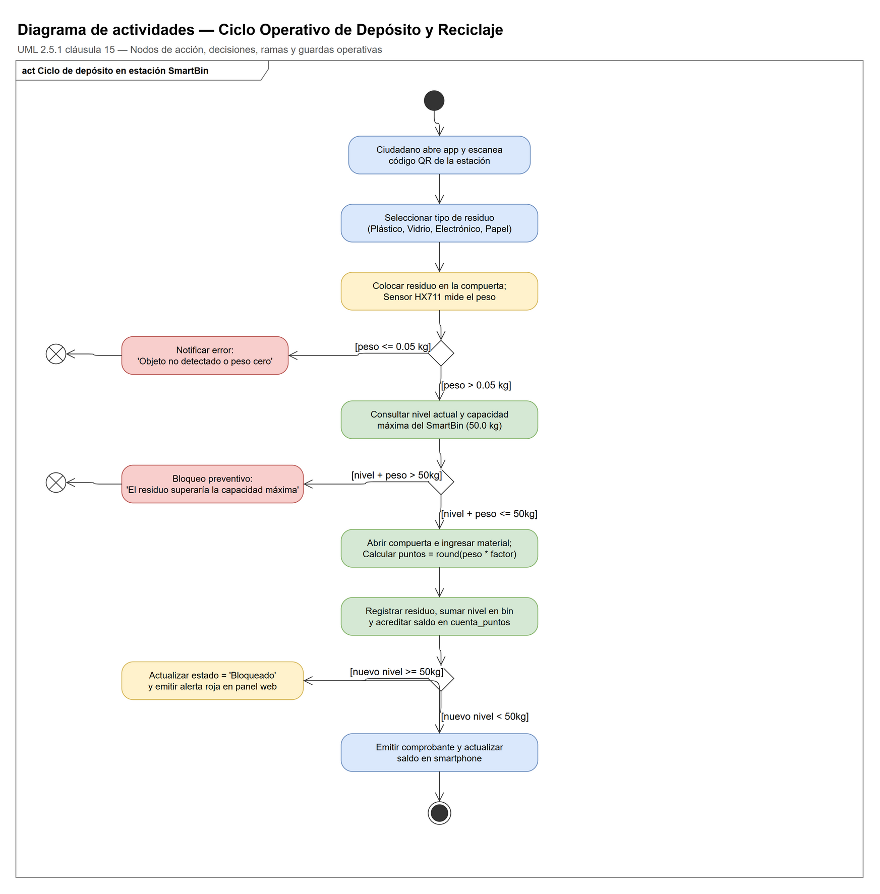

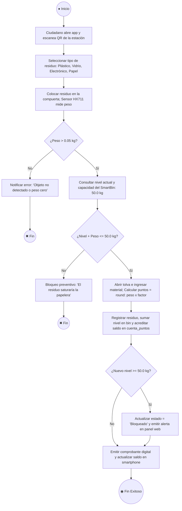

---

#### 2.3.5 Diagrama de Máquina de Estados (OMG UML 2.5.1, Cláusula 14)

> **Archivos Oficiales:** `diagramas/05-estados.drawio` | `diagramas/05-estados.png`  
> **Convenciones Aplicadas:** Marco formal `stm`, estados finitos con invariantes, acciones internas `entry /` y `do /`, y estado compuesto para el protocolo de mantenimiento de la cuadrilla de aseo.

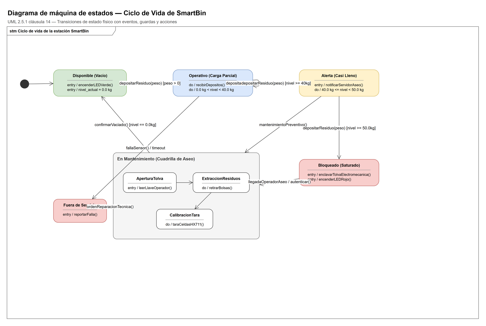

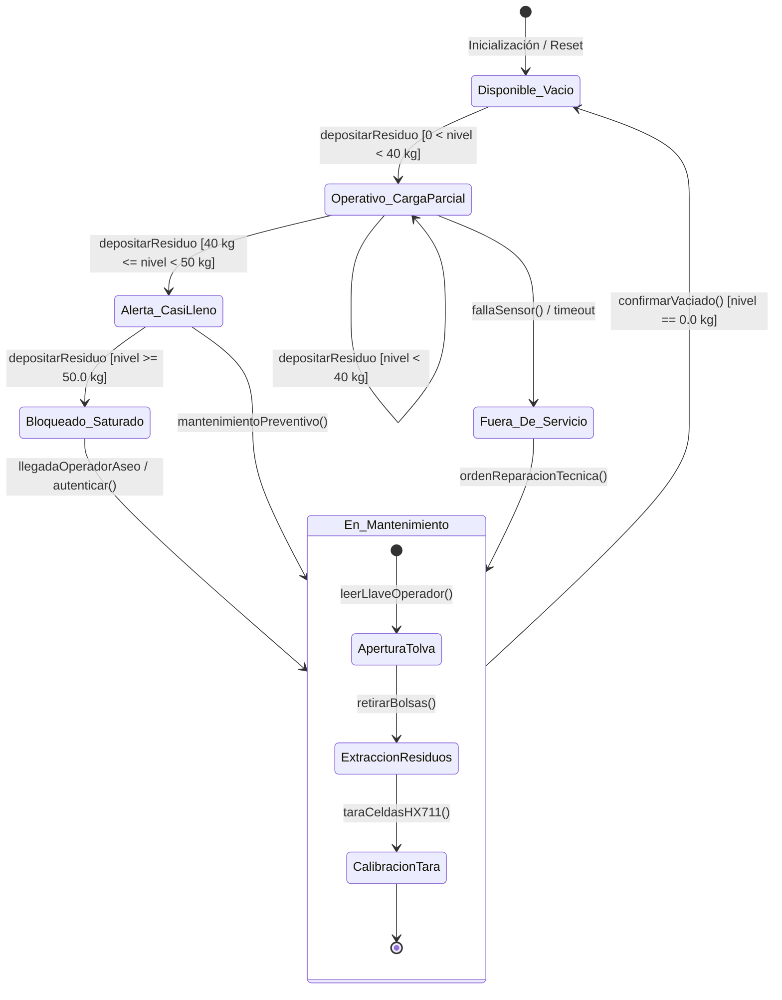

---

#### 2.3.6 Diagrama de Componentes (OMG UML 2.5.1, Cláusula 11.6 y 10.4)

> **Archivos Oficiales:** `diagramas/06-componentes.drawio` | `diagramas/06-componentes.png`  
> **Convenciones Aplicadas:** Simbología oficial OMG UML 2.5.1 con ícono de clasificador en la esquina superior derecha, interfaces provistas (bola ○ / lollipop) implementadas por el API Gateway y conector SQL, e interfaces requeridas (medio círculo Ɑ / socket) por los clientes y adaptadores. Ensamble directo de interfaces y delegación interna.

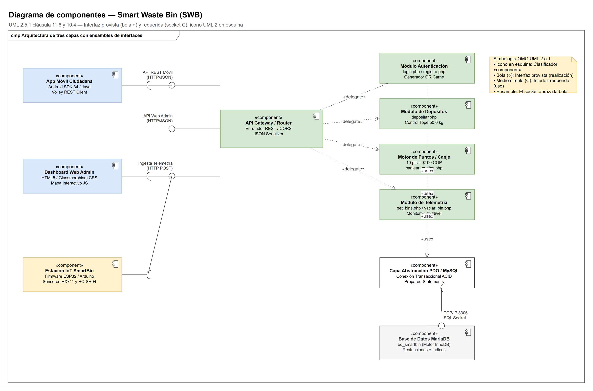

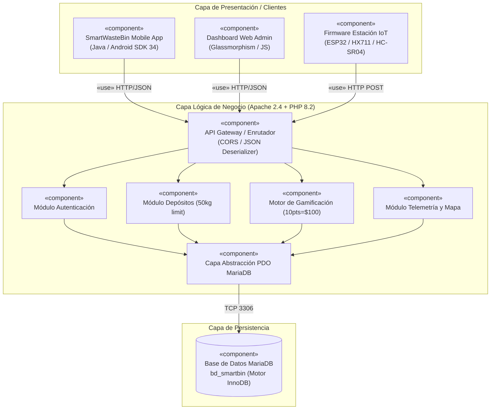

---

#### 2.3.7 Diagrama de Arquitectura de Despliegue (OMG UML 2.5.1, Cláusula 19)

> **Archivos Oficiales:** `diagramas/07-despliegue.drawio` | `diagramas/07-despliegue.png`  
> **Convenciones Aplicadas:** Nodos físicos cúbicos en perspectiva (`«device»` y `«executionEnvironment»`), artefactos con icono de documento y canales de comunicación con protocolos explícitos.

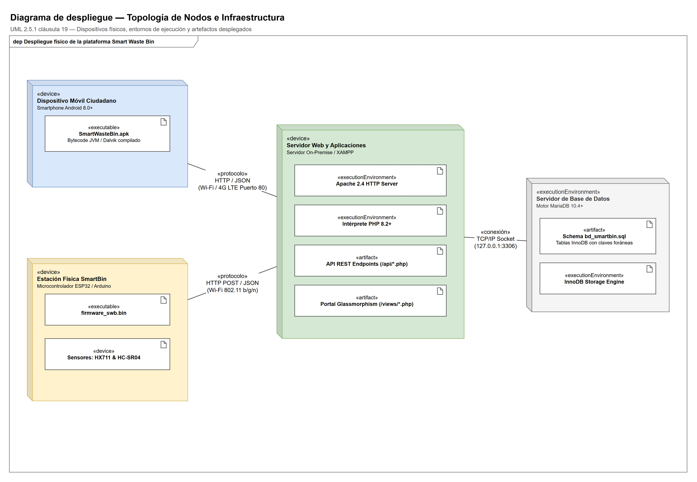

```mermaid
flowchart TD
    subgraph N_Movil["«device»\nSmartphone Ciudadano (Android 8.0+)"]
        Art_APK["«executable»\nSmartWasteBin.apk"]
    end

    subgraph N_IoT["«device»\nEstación Física SmartBin (ESP32)"]
        Art_BIN["«executable»\nfirmware_swb.bin"]
        Art_SENS["«device»\nSensores HX711 y HC-SR04"]
    end

    subgraph N_Srv["«device»\nServidor Web y Aplicaciones (XAMPP)"]
        subgraph Env_Apache["«executionEnvironment» Apache 2.4"]
            subgraph Env_PHP["«executionEnvironment» PHP 8.2 Engine"]
                Art_API["«artifact» Endpoints REST (/api/*.php)"]
                Art_Web["«artifact» Portal Web (/views/*.php)"]
            end
        end
    end

    subgraph N_DB["«executionEnvironment»\nServidor MariaDB 10.4+"]
        Art_SQL["«artifact» bd_smartbin.sql (Motor InnoDB)"]
    end

    N_Movil <-->|HTTP / JSON (Puerto 80 / LTE / Wi-Fi)| N_Srv
    N_IoT <-->|HTTP POST / JSON (Wi-Fi 802.11 b/g/n)| N_Srv
    Env_PHP <-->|Socket TCP/IP 127.0.0.1:3306| N_DB
```

---

#### 2.3.8 Diagrama de Paquetes (OMG UML 2.5.1, Cláusula 12)

> **Archivos Oficiales:** `diagramas/08-paquetes.drawio` | `diagramas/08-paquetes.png`  
> **Convenciones Aplicadas:** Carpetas con pestaña superior izquierda para el namespace Android `com.unicolombo.smartwastebin` y el árbol backend `/Smart_waste_bin_6to_semestre`.

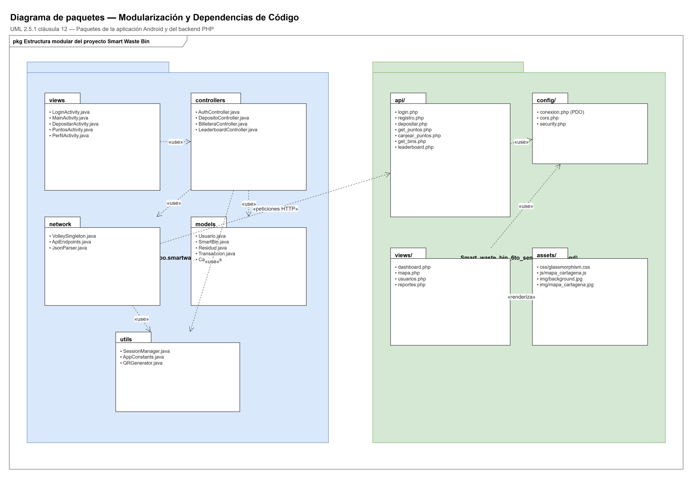

```mermaid
flowchart TB
    subgraph PKG_Android["com.unicolombo.smartwastebin (Android)"]
        P_Views["views\n(LoginActivity, MainActivity, DepositarActivity)"]
        P_Ctrls["controllers\n(AuthController, DepositoController, BilleteraController)"]
        P_Models["models\n(Usuario, SmartBin, Residuo, Transaccion)"]
        P_Net["network\n(VolleySingleton, ApiEndpoints, JsonParser)"]
        P_Utils["utils\n(SessionManager, AppConstants)"]
    end

    subgraph PKG_Backend["Smart_waste_bin_6to_semestre (Backend PHP)"]
        P_API["api/\n(login.php, depositar.php, get_puntos.php, get_bins.php)"]
        P_Cfg["config/\n(conexion.php, cors.php)"]
        P_WebViews["views/\n(dashboard.php, mapa.php, usuarios.php)"]
        P_Assets["assets/\n(css/, js/, img/)"]
    end

    P_Views ..> P_Ctrls
    P_Ctrls ..> P_Models
    P_Ctrls ..> P_Net
    P_Ctrls ..> P_Utils
    P_Net ..>|«peticiones HTTP»| P_API
    P_API ..> P_Cfg
    P_WebViews ..> P_Cfg
    P_WebViews ..> P_Assets
```

---

#### 2.3.9 Diagrama de Comunicación (OMG UML 2.5.1, Cláusula 17.9)

> **Archivos Oficiales:** `diagramas/09-comunicacion.drawio` | `diagramas/09-comunicacion.png`  
> **Convenciones Aplicadas:** Enlaces estructurales representados con líneas sólidas, flechas paralelas de dirección de mensaje y numeración jerárquica estricta.

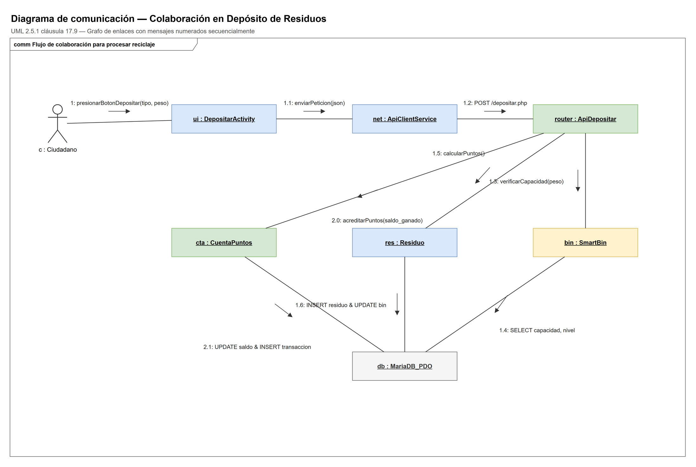

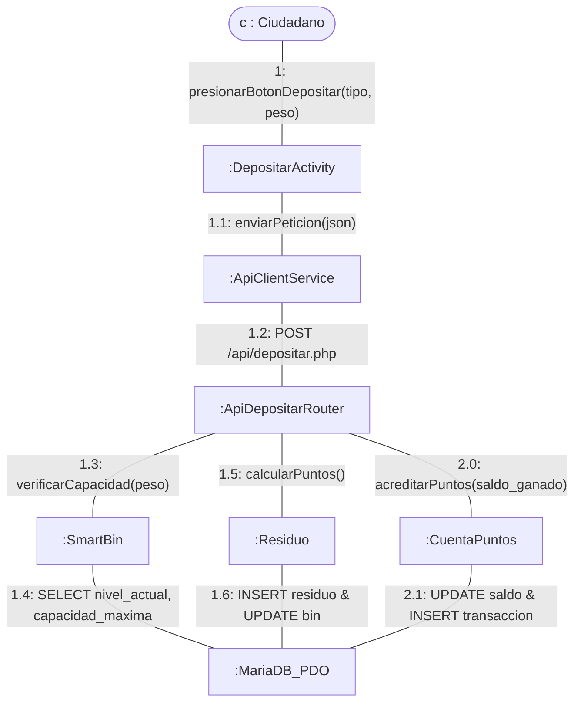

---

#### 2.3.10 Diagrama de Objetos (OMG UML 2.5.1, Cláusula 9.8)

> **Archivos Oficiales:** `diagramas/10-objetos.drawio` | `diagramas/10-objetos.png`  
> **Convenciones Aplicadas:** Instancias con nombres subrayados (`<u>nombre : Clase</u>`) y valores concretos extraídos del estado real de la base de datos `bd_smartbin`.

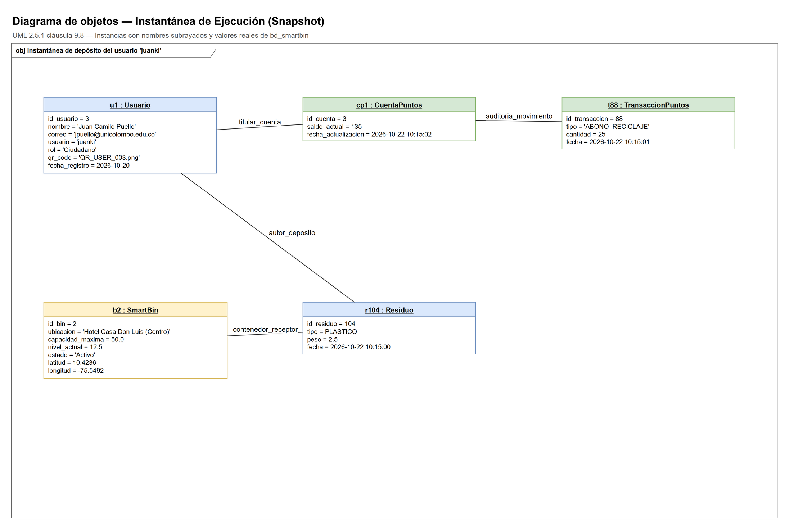

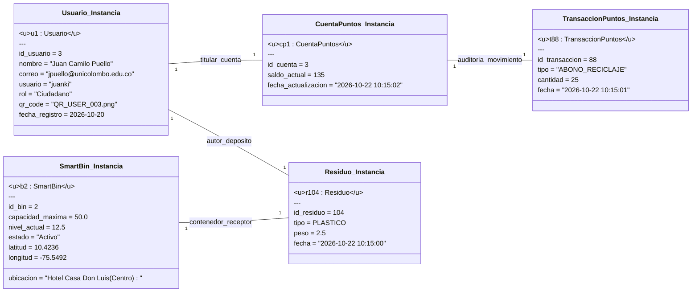

---

---

### 2.4 Administración de Usuarios y Seguridad

La plataforma gestiona el control de acceso mediante roles almacenados en la tabla `usuario`:
- **Rol `user` (Ciudadano):** Acceso acotado a su propio tablero, consulta de puntos personales, registro de residuos, mapa de contenedores, canje de premios y tabla de clasificación general.
- **Rol `admin` (Operador / Supervisor de Aseo):** Acceso al panel administrativo integral (`AdminPanel.php`). Incluye facultades de telemetría de toda la red de contenedores, ejecución de vaciado operativo de depósitos (`vaciar_bin.php`), supervisión de transacciones consolidadas y depuración de usuarios infractores (`eliminar_usuario_admin.php`).

#### Mecanismos de Seguridad Implementados
1. **Control de Sesión:** Cada página operativa PHP invoca `session_start()` e inspecciona la presencia de `$_SESSION['user_id']`. Si la variable no existe, expulsa la solicitud mediante redirección HTTP a `login.html`.
2. **Sanitización de Datos:** Invocación de `mysqli_real_escape_string()` y casteo de tipos estrictos (`intval()`, `floatval()`) sobre variables de entrada para mitigar vulnerabilidades de inyección SQL.
3. **Transacciones ACID Protegidas:** Los retiros monetarios y canjes de puntos se agrupan en bloques `mysqli_begin_transaction()` con captura de excepciones (`try/catch`) y `mysqli_rollback()` en caso de fallos de escritura.

---

### 2.5 Modelo de Datos: DER, Modelo Relacional y Diccionario

#### 2.5.1 Modelo Entidad-Relación (DER - Notación de Chen)

> **Archivos Oficiales:** `diagramas/12-der.drawio` | `diagramas/12-der.png`  
> **Convenciones Aplicadas:** Notación de Chen (Elmasri & Navathe). Entidades (rectángulos), relaciones (rombos), atributos (óvalos con PK subrayada) y participación total mediante doble línea (`CUENTA_PUNTOS`, `TRANSACCION_PUNTOS` y `RESIDUO`).

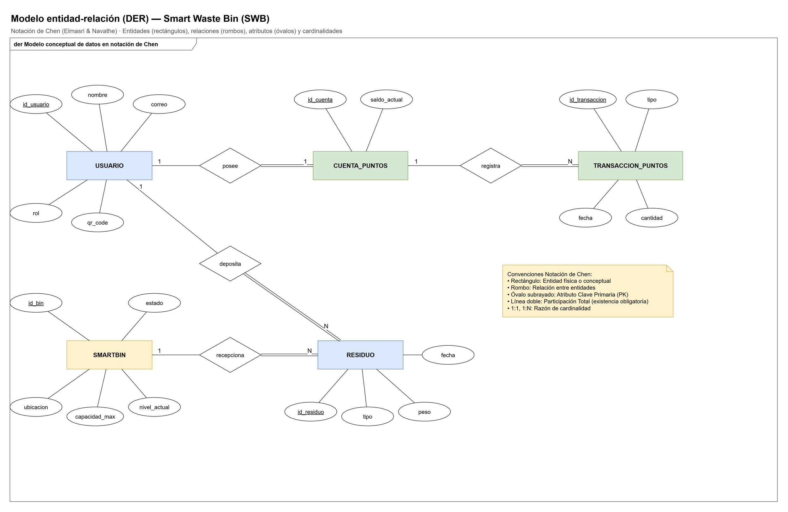

* **Entidades:** `USUARIO`, `CUENTA_PUNTOS`, `TRANSACCION_PUNTOS`, `SMARTBIN`, `RESIDUO`.
* **Relaciones:**
  * `posee`: USUARIO (1, parcial) ── posee ── (1, total) CUENTA_PUNTOS
  * `registra`: CUENTA_PUNTOS (1, parcial) ── registra ── (N, total) TRANSACCION_PUNTOS
  * `deposita`: USUARIO (1, parcial) ── deposita ── (N, total) RESIDUO
  * `recepciona`: SMARTBIN (1, parcial) ── recepciona ── (N, total) RESIDUO

---

#### 2.5.2 Modelo Relacional (Perfil de Ambler)

> **Archivos Oficiales:** `diagramas/11-modelo-relacional.drawio` | `diagramas/11-modelo-relacional.png`  
> **Convenciones Aplicadas:** Perfil de datos de Ambler. Tablas físicas MariaDB InnoDB con etiquetas explícitas `«PK»`, `«FK»` y `«UK»`, tipos de datos y multiplicidades en extremos de enlaces foráneos.

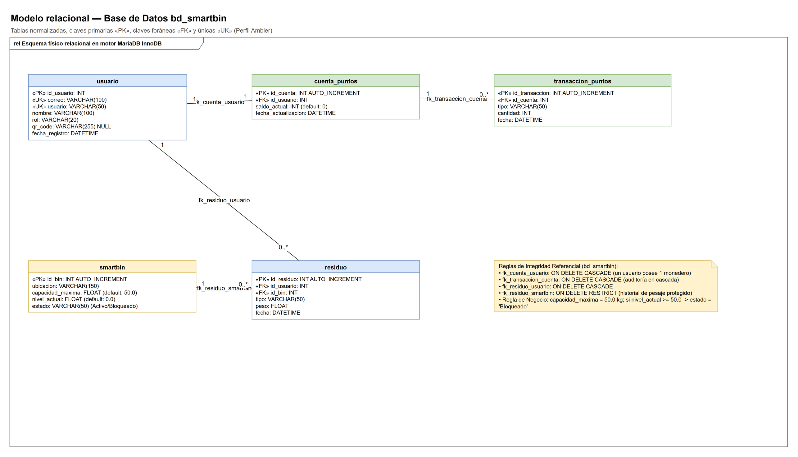

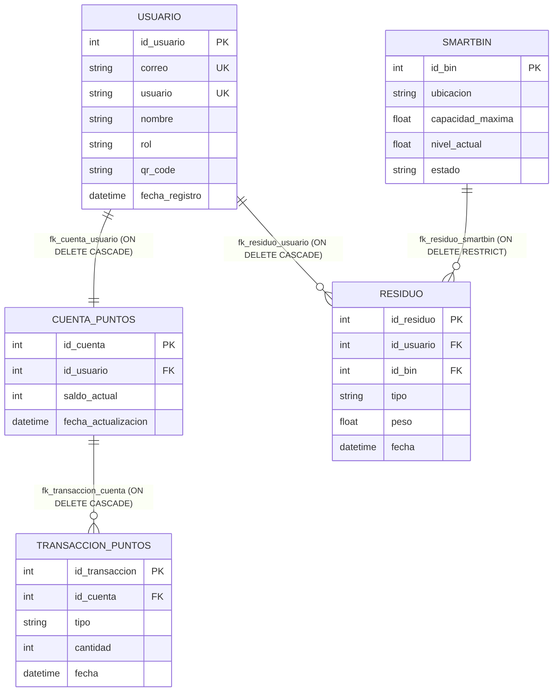

---

#### 2.5.3 Diccionario de Datos Exhaustivo

##### Tabla: `usuario`
Almacena los datos personales y de acceso de los ciudadanos y administradores.

| Columna | Tipo de Dato | Nulo | Clave | Predeterminado | Descripción |
| :--- | :--- | :---: | :---: | :--- | :--- |
| `id_usuario` | `INT(5)` | NO | **PK** | Ninguno | Identificador único del usuario (Cédula o código institucional). |
| `nombre` | `VARCHAR(100)` | SÍ | - | NULL | Nombres y apellidos completos. |
| `correo` | `VARCHAR(100)` | SÍ | **UK** | NULL | Dirección de correo electrónico única. |
| `usuario` | `VARCHAR(50)` | SÍ | - | NULL | Nombre de usuario utilizado para el ingreso (apodo / alias). |
| `rol` | `VARCHAR(20)` | SÍ | - | `'user'` | Nivel de privilegios del usuario (`'user'` o `'admin'`). |
| `qr_code` | `VARCHAR(255)` | SÍ | - | `'QR_GENERADO'` | Código alfanumérico para validación en campo con lector QR. |
| `fecha_registro` | `DATETIME` | SÍ | - | `CURRENT_TIMESTAMP` | Fecha y hora del registro inicial. |

##### Tabla: `cuenta_puntos`
Gestiona el monedero digital y balance actual de eco-puntos del ciudadano.

| Columna | Tipo de Dato | Nulo | Clave | Predeterminado | Descripción |
| :--- | :--- | :---: | :---: | :--- | :--- |
| `id_cuenta` | `INT(11)` | NO | **PK** | `AUTO_INCREMENT` | Identificador autoincremental de la cuenta de puntos. |
| `id_usuario` | `INT(5)` | SÍ | **FK** | NULL | Identificador del usuario titular (`usuario.id_usuario`). |
| `saldo_actual` | `INT(11)` | SÍ | - | `0` | Cantidad neta de puntos acumulados disponibles para canje. |
| `fecha_actualizacion` | `DATETIME` | SÍ | - | `CURRENT_TIMESTAMP` | Fecha y hora de la última modificación del saldo. |

##### Tabla: `smartbin`
Registra las papeleras inteligentes físicas desplegadas en la ciudad, su localización y su nivel de carga.

| Columna | Tipo de Dato | Nulo | Clave | Predeterminado | Descripción |
| :--- | :--- | :---: | :---: | :--- | :--- |
| `id_bin` | `INT(11)` | NO | **PK** | `AUTO_INCREMENT` | Identificador único del contenedor físico inteligente. |
| `ubicacion` | `VARCHAR(150)` | SÍ | - | NULL | Dirección física o hito turístico (ej. 'Hotel Casa Don Luis'). |
| `capacidad_maxima` | `FLOAT` | SÍ | - | `50.0` | Capacidad máxima en kilogramos permitida antes del desborde. |
| `nivel_actual` | `FLOAT` | SÍ | - | `0.0` | Carga física acumulada en kilogramos en tiempo real. |
| `estado` | `VARCHAR(50)` | SÍ | - | `'Activo'` | Estado de disponibilidad (`'Activo'` o `'Bloqueado'`). |

##### Tabla: `residuo`
Bitácora de cada depósito de material reciclable ejecutado en la red.

| Columna | Tipo de Dato | Nulo | Clave | Predeterminado | Descripción |
| :--- | :--- | :---: | :---: | :--- | :--- |
| `id_residuo` | `INT(11)` | NO | **PK** | `AUTO_INCREMENT` | Identificador único del registro de residuo. |
| `id_usuario` | `INT(5)` | SÍ | **FK** | NULL | Usuario que realizó el depósito (`usuario.id_usuario`). |
| `id_bin` | `INT(11)` | SÍ | **FK** | NULL | Papelera receptora del material (`smartbin.id_bin`). |
| `tipo` | `VARCHAR(50)` | SÍ | - | NULL | Tipo de material (`'PLASTICO'`, `'ORGANICO'`, `'ELECTRONICO'`, `'PAPEL_CARTON'`). |
| `peso` | `FLOAT` | SÍ | - | NULL | Peso exacto registrado en kilogramos (ej. 1.85). |
| `fecha` | `DATETIME` | SÍ | - | `CURRENT_TIMESTAMP` | Estampa de tiempo exacta del depósito. |

##### Tabla: `transaccion_puntos`
Registro contable inmutable de todo movimiento crediticio o debitorio de puntos.

| Columna | Tipo de Dato | Nulo | Clave | Predeterminado | Descripción |
| :--- | :--- | :---: | :---: | :--- | :--- |
| `id_transaccion` | `INT(11)` | NO | **PK** | `AUTO_INCREMENT` | Identificador autoincremental de la transacción contable. |
| `id_cuenta` | `INT(11)` | SÍ | **FK** | NULL | Cuenta de puntos afectada (`cuenta_puntos.id_cuenta`). |
| `tipo` | `VARCHAR(50)` | SÍ | - | NULL | Concepto (`'DEPOSITO_PLASTICO'`, `'RETIRO_TEL_315...'`). |
| `cantidad` | `INT(11)` | SÍ | - | NULL | Monto entero de puntos acreditados o debitados. |
| `fecha` | `DATETIME` | SÍ | - | `CURRENT_TIMESTAMP` | Fecha y hora en la que ocurrió la transacción. |

---

### 2.6 Descripción de la Plataforma de Ejecución e Infraestructura

El sistema ha sido concebido para operar bajo el stack clásico y de alta fiabilidad **LAMP / WAMP**:

| Componente | Tecnología Seleccionada | Versión Mínima | Justificación Técnica |
| :--- | :--- | :--- | :--- |
| **Sistema Operativo** | Windows 10/11 / Linux Ubuntu Server | 64 bits | Estabilidad operativa y compatibilidad universal con entornos educativos y productivos. |
| **Servidor Web** | Apache HTTP Server | 2.4.58+ | Alta concurrencia, soporte nativo de módulos de reescritura y manejo de sockets HTTP. |
| **Lenguaje Backend** | PHP | 8.2+ | Lenguaje interpretado del lado del servidor, tipado estricto, alta velocidad de procesamiento y driver nativo `mysqli`. |
| **Motor de Base de Datos** | MariaDB Server / MySQL | 10.4.32+ | Motor de almacenamiento InnoDB, soporte estricto de integridad referencial y transacciones ACID. |
| **Frontend / UI** | HTML5, CSS3 Glassmorphism, JS Vanilla | Estándar W3C | Independencia de frameworks externos pesados; diseño visual ligero, responsivo y estético con fondos dinámicos. |
| **Suite de Entorno** | XAMPP Control Panel | v3.3.0 | Despliegue rápido local con orquestación integrada de Apache, MySQL y phpMyAdmin. |

---

### 2.7 Documentación del Código Fuente y Estructura de Directorios

#### 2.7.1 Árbol de Componentes del Proyecto

El código fuente del sistema se encuentra organizado bajo una separación modular limpia entre lógica controladora, vistas de usuario y recursos multimedia:

```text
Smart_waste_bin_6to_semestre/
│
├── background.jpg                  # Imagen de follaje tropical (fondo institucional CSS)
├── mapa_cartagena.jpg              # Cartografía física georreferenciada del Centro Histórico
├── bd_smartbin.sql                 # Script DDL/DML de estructura y datos iniciales de base de datos
│
├── index.html                      # Portal de aterrizaje y bienvenida principal
├── login.html                      # Formulario visual de inicio de sesión
├── login.php                       # Controlador de autenticación y gestión de sesiones
├── insertar_usuario.html           # Formulario visual de registro de nuevo ciudadano
├── insertar_usuario.php            # Controlador de inserción de usuario y apertura de monedero
│
├── CuentaPuntos.php                # Controlador del dashboard (calcula rango, saldo y total kg)
├── CuentaPuntos.view.php           # Vista visual del dashboard del usuario
│
├── RegistrarResiduos.php           # Controlador de vista para el formulario de pesaje
├── RegistrarResiduos.view.php      # Vista del formulario de selección de residuo y contenedor
├── procesar_deposito.php           # Controlador transaccional: valida cupo, calcula puntos y actualiza
│
├── MapaSmartBins.php               # Controlador que extrae las coordenadas y estado de los 8 bins
├── MapaSmartBins.view.php          # Vista cartográfica con marcadores animados interactivos
│
├── RetirarPuntos.php               # Controlador que calcula equivalencias COP del saldo disponible
├── RetirarPuntos.view.php          # Vista del formulario de canje / transferencia a líneas móviles
├── procesar_retiro.php             # Controlador transaccional ACID para debitar puntos del monedero
│
├── Transacciones.php               # Controlador que consulta el extracto contable del usuario
├── Transacciones.view.php          # Vista con tabla estilizada del historial de movimientos
│
├── Clasificacion.php               # Controlador que extrae el top global de recicladores
├── Clasificacion.view.php          # Vista comunitaria de clasificación (Leaderboard / medallas)
│
├── AdminPanel.php                  # Controlador maestro del panel administrativo
├── AdminPanel.view.php             # Vista de telemetría de bins, vaciado y gestión de usuarios
├── vaciar_bin.php                  # Controlador que ejecuta el restablecimiento a 0.0 kg del bin
├── eliminar_usuario_admin.php      # Controlador para dar de baja usuarios desde el panel admin
│
├── EditarCuenta.php                # Controlador de precarga de información personal
├── EditarCuenta.view.php           # Vista del formulario de edición de datos de perfil
├── procesar_edicion.php            # Controlador de actualización de atributos del usuario
├── eliminar_cuenta.php             # Controlador de auto-eliminación de cuenta de usuario
│
└── db.php                          # Módulo global de conexión persistente a MariaDB (mysqli)
```

---

#### 2.7.2 Catálogo Detallado de Módulos y Scripts

| Archivo / Script | Tipo | Entradas (Inputs) | Salidas (Outputs) | Descripción Funcional |
| :--- | :---: | :--- | :--- | :--- |
| `db.php` | Conexión | Host, usuario, clave, base de datos | Objeto `$conn` (`mysqli`) | Centraliza la conexión al motor de base de datos; detiene la ejecución si ocurre una falla de socket. |
| `login.php` | Controlador | `POST['usuario']` | Redirección HTTP / `$_SESSION` | Valida credenciales contra `usuario`, inicializa sesión y bifurca la navegación según rol (`admin` o `user`). |
| `insertar_usuario.php` | Controlador | `id_usuario`, `nombre`, `correo`, `usuario` | Registro en BD / Redirección | Crea el registro en `usuario` y simultáneamente genera su registro en `cuenta_puntos` con saldo cero. |
| `CuentaPuntos.php` | Controlador | `$_SESSION['user_id']` | Variables para la vista | Consulta nombre, saldo actual, suma total de kg reciclados y computa el rango ecológico (`Novato`, etc.). |
| `procesar_deposito.php`| Controlador | `tipo`, `peso`, `bin` | Transacciones en BD | Aplica reglas de negocio: valida llenado, multiplica por factor de material, inserta residuo y transacciona puntos. |
| `MapaSmartBins.php` | Controlador | Consulta a `smartbin` | Array asociativo `$smartbins` | Extrae el estado, capacidad y nivel de cada uno de los 8 contenedores turísticos de Cartagena. |
| `procesar_retiro.php` | Controlador | `telefono`, `cantidad` | Transacción ACID | Comprueba saldo suficiente, valida formato móvil colombiano (10 dígitos, inicia por 3) y descuenta puntos. |
| `vaciar_bin.php` | Admin | `GET['id']` | Actualización de BD | Restablece `nivel_actual = 0.0` y desbloquea el contenedor `estado = 'Activo'`. |

---

### 2.8 Acuerdos de Niveles de Servicio (ANS / SLA) y Matriz de Escalamiento

Para garantizar la continuidad operativa de la plataforma y de los contenedores inteligentes en campo, se estipula la siguiente matriz de acuerdos de servicio:

| Severidad | Definición del Incidente | Tiempo Máximo de Respuesta | Tiempo Máximo de Solución | Responsable Asignado |
| :---: | :--- | :---: | :---: | :--- |
| **Nivel 1 (Crítico)** | Caída total de la base de datos MariaDB o indisponibilidad completa del servidor Apache. Imposibilidad de registrar depósitos en toda la red urbana. | **< 30 minutos** | **< 2 horas** | Administrador de Infraestructura y Servidor (Klever Polo) |
| **Nivel 2 (Alto)** | Papelera inteligente bloqueada físicamente por alcanzar capacidad máxima (50 kg) que no permite depósitos en punto de alto tráfico. | **< 1 hora** | **< 4 horas** | Cuadrilla de Operadores de Aseo y Vaciado Urbano |
| **Nivel 3 (Medio)** | Inconsistencias o demoras en la visualización del saldo de eco-puntos tras un depósito válido. | **< 4 horas** | **< 12 horas** | Desarrollador Backend (Juan Caro / Robert Pérez) |
| **Nivel 4 (Bajo)** | Dificultades de acceso por olvido de identificador de usuario, consultas cosméticas de interfaz o solicitudes de cambio de alias. | **< 8 horas** | **< 24 horas** | Mesa de Ayuda de Primer Nivel (Diego Mejía) |

---

# Glosario de Términos

- **ANS (Acuerdo de Niveles de Servicio / SLA):** Compromiso formal entre los responsables tecnológicos y los usuarios que establece los tiempos de respuesta y solución ante incidentes.
- **Glassmorphism:** Paradigma moderno de diseño de interfaz de usuario caracterizado por fondos translúcidos, desenfoque óptico (`backdrop-filter: blur`), bordes sutiles y sombras de profundidad que simulan paneles de vidrio esmerilado.
- **IoT (Internet of Things):** Red de objetos físicos interconectados provistos de sensores, componentes de hardware y software que transmiten datos operativos a través de redes telemáticas.
- **MariaDB / MySQL:** Sistema gestor de bases de datos relacionales (SGBD) de alto rendimiento basado en tablas y lenguaje SQL estructurado.
- **SmartBin:** Contenedor de residuos dotado de instrumentación electrónica (sensores de ultrasonido y balanzas digitales) capaz de reportar de forma autónoma su volumen y peso.
- **Transacción ACID:** Conjunto de operaciones en base de datos que garantizan Atomicidad, Consistencia, Aislamiento (Isolation) y Durabilidad, impidiendo estados parciales en retiros o abonos de saldo.
- **UML (Unified Modeling Language):** Estándar internacional para la especificación, visualización, construcción y documentación de los artefactos de un sistema de software.

---

# Referencias Bibliográficas

1. **IEEE Computer Society.** (2001). *IEEE Std 1063-2001: IEEE Standard for Software User Documentation*. IEEE Standards Association. Piscataway, NJ, USA.
2. **Servicio Nacional de Aprendizaje (SENA).** (2020). *Manuales Técnicos de la Aplicación*. Centro Industrial de Mantenimiento Integral (CIMI) - Regional Santander. Formación en Ambientes Virtuales de Aprendizaje (FAVA).
3. **Pressman, R. S., & Maxim, B. R.** (2020). *Software Engineering: A Practitioner's Approach* (9th ed.). McGraw-Hill Education.
4. **Sommerville, I.** (2019). *Ingeniería del Software* (10.ª ed.). Pearson Educación.
5. **The PHP Group.** (2026). *PHP Manual: MySQL Improved Extension (mysqli)*. Recuperado de `https://www.php.net/manual/es/book.mysqli.php`.

---

# Control del Documento

| Nombre del Proyecto | Sistema de Gestión y Gamificación de Papeleras Inteligentes (Smart Waste Bin) |
| :--- | :--- |
| **Materia / Contexto** | Proyecto de Aula - 6to Semestre |
| **Institución Universitaria** | Fundación Universitaria Colombo Internacional (UNICOLOMBO) |
| **Programa Académico** | Ingeniería de Sistemas |
| **Ciudad y Fecha** | Cartagena de Indias D.T. y C., Octubre de 2026 |

### Registro de Autores y Asesores
- **Líder Técnico de Desarrollo y Arquitectura:** Klever Adriano Polo Bolívar
- **Desarrollador de Módulos y Lógica de Negocio:** Juan Caro Ramírez
- **Analista de Requerimientos y Casos de Uso:** Diego Mejía Espinosa
- **Diseñador de Datos y Especificación de Dominio:** Robert Pérez Maza
- **Docente Orientador / Director de Cátedra:** Ing. Juan José Puello Beltrán
